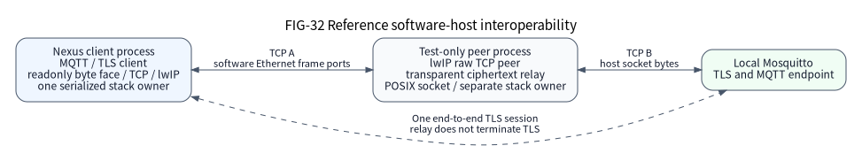

# Optional common components

These declarations come from public header files. Selection, lifecycle, supported execution modes and physical authorization remain bounded by the corresponding design and support records.

## Byte transport, TLS and MQTT composition

`byte_stream.h` defines immediate partial reads and copied writes with finite
absolute deadlines. SUCCESS reports local byte acceptance, not peer delivery;
BUSY with zero bytes requires explicit owner progress. No caller buffer remains
borrowed after a stream operation returns. The optional `Nexus::LwIPTCP` client
implements this face over the pinned NO_SYS IPv4 stack. Products still own the
executor, peer selection, trusted time, entropy and shutdown/reconnect policy.

| Consumer | Selected target and header | Boundary |
| --- | --- | --- |
| Generic Ethernet adapter caller | `Nexus::LwIP`, `nexus/network/lwip_adapter.h` | Nexus types; no supplier headers or profile macros |
| Generic TCP byte caller | `Nexus::LwIPTCP`, `nexus/network/lwip_tcp.h` | Opaque client and the existing readonly byte face |
| Static netif composition | `Nexus::LwIPStorage`, `nexus/network/lwip_storage.h` | Exact pinned netif/adapter layout, composition only |
| Static TCP composition | `Nexus::LwIPTCPStorage`, `nexus/network/lwip_tcp_storage.h` | Exact pinned PCB/pbuf client layout, composition only |

The composition initializes lwIP once and supplies a live network adapter,
caller-owned storage and a positive receive-frame budget. All raw stack APIs,
callbacks, network service and clients share one serialized NO_SYS executor.
Call facade data/control outside raw callbacks; nested cross-facade mutation is
rejected with BUSY.
No socket layer, worker, scheduler, lock, name registry or maximum opaque pool is
created. A successful TCP start admits CONNECTING; it does not establish the
connection. Its first finite connect deadline cannot be extended. The existing
byte face is a stateful handle, not a readiness proof.

TCP writes use official copied admission: a positive partial count releases the
caller input immediately, while queued data remains bounded stack storage.
Later output failure cannot undo that acceptance. Diagnostics continue to report
that failure, and subsequent data/service calls fail until explicit abort. RX holds at most one accepted pbuf chain;
refused chains stay lwIP-owned. Only consumed bytes receive credit. Buffered
bytes precede orderly FIN, and peer half-close still permits writes. A frame
budget bounds acquisition, not the total wall time of arbitrary raw callbacks.
Each nonzero byte attempt may perform one explicitly budgeted network pass.

Official PCB allocation shares the bounded stack pool and its reclamation policy.
It may progress pending closes or reclaim TIME_WAIT, LAST_ACK, CLOSING and
lower-priority active connections, invoking other clients' error callbacks even
if the new start later fails. Local rejection retains no new references for that
client; it does not promise a globally unchanged stack.

After producers join, the owner consumes buffered RX and explicitly progresses
and retries close on BUSY under the first finite close deadline. That deadline
cannot be extended. Timeout requires explicit abort while storage stays live;
abort discards local data and detaches callbacks. Successful
close proves this client context's final stack access. The official stack may
still own deferred FIN and TIME_WAIT state. Preserve the network adapter, global
pools, timers and unchanged clock domain until the product's complete stack
shutdown/restart procedure permits withdrawal. Client detachment does not prove
global stack shutdown or MAC/PHY drain.

Ordinary TLS/MQTT consumers include `tls.h` or `client.h` and link `Nexus::TLS` or
`Nexus::CoreMQTT`. Their public session types are opaque and expose no supplier
headers or profile macros. Only the static composition translation unit selects
`Nexus::TLSStorage` with `nexus/tls/storage.h`, or `Nexus::CoreMQTTStorage` with
`nexus/mqtt/core_mqtt_storage.h`, to allocate the exact pinned backend layout.
Keep explicit storage targets local to composition; fields are implementation
state, not business control APIs or binary ABI promises. Products explicitly call
`nexus_add_tls()` or `nexus_add_coremqtt()` to create the selected targets.

The TLS profile is one serialized TLS 1.2 client/PSA domain using
ECDHE-ECDSA P-256 and AES-128-GCM/SHA-256. It requires explicit DER trust,
trusted UTC and a reviewed entropy-quality assertion. Its 64 KiB caller arena
and 512 B TX stage exclude session metadata, transport memory and stack. Join
facade users, abort the session, then stop the runtime; failed or BUSY cleanup
retains its resources. The MQTT 3.1.1 profile provides clean sessions and QoS0/1;
callbacks borrow incoming views only until return. Explicit DISCONNECT and TLS
close report local progress and do not replace lower-layer drain or peer
acknowledgement. The component contracts detail
[network](../../../components/network/README.md),
[TLS](../../../components/tls/README.md) and
[MQTT](../../../components/mqtt/README.md) ownership and fixed profile limits.

For both Ethernet adapter profiles, successful link output reports frame
admission. A failed SETTLED TX outcome remains observable once through
`nx_lwip_adapter_service`; until that observation, another link output cannot
overwrite or reuse the TX buffer. Observing the error clears only the settled,
unborrowed request. It adds no error queue or instance storage and does not
reset the MAC, replay a packet or choose a product recovery policy. An ACTIVE
or QUARANTINED borrow remains retained. The TCP byte facade keeps its existing
connection-failure policy; frame-error observation does not promise recovery.

(lwip-loaned-rx-contract)=

## Selected lwIP RX payload loans

Select one singleton NO_SYS stack profile per image. The default
`Nexus::LwIP` and `Nexus::LwIPTCP` profiles retain copied RX and their existing
storage layouts. The explicit targets below select RX payload loans; CMake
rejects an image combining copied and loaned profiles, including a copied TCP
target combined with loaned adapter storage. These targets create no second
stack, netif, executor, worker or allocator.

| Consumer | Selected target and header | Boundary |
| --- | --- | --- |
| Loaned RX adapter caller | `Nexus::LwIPLoanedRX`, `nexus/network/lwip_loaned_rx.h` | Opaque adapter; explicit loaned start |
| Loaned RX TCP byte caller | `Nexus::LwIPTCPLoanedRX`, `nexus/network/lwip_tcp.h` | Existing copied byte-stream contract |
| Static loaned RX composition | `Nexus::LwIPLoanedRXStorage`, `nexus/network/lwip_loaned_rx_storage.h` | Exact adapter, frame-slot and custom-pbuf storage |
| Static TCP composition over loaned RX | `Nexus::LwIPTCPLoanedRXStorage`, `nexus/network/lwip_tcp_storage.h` | Exact selected TCP layout; also provide loaned adapter storage |

The owner initializes lwIP once and attaches with
`nx_lwip_loaned_adapter_start`. Supply zero-initialized, disjoint adapter, TX,
fragment-view, frame-slot and custom-pbuf-piece storage. Select a nonzero
`slot_count` and at least `slot_count * base.rx_capacity` pieces, with fragment
capacity sized for the actual provider geometry. MAC payload spans must also
be disjoint from adapter, TX/view and slot/piece storage. Invalid acquired
spans are released without delivery. All raw APIs, reference operations,
callbacks, service and stop share the same serialized, nonreentrant task owner.
Live or reentrant attachment cannot erase retained references or tokens.

```text
Nexus::LwIPLoanedRXStorage -> adapter + caller slots/pieces
MAC exact RX loan -> copied REF header[136] -> immutable ROM tails
final pbuf_free -> slot ready -> owner service/stop -> exact MAC release
```

Each frame slot copies at most 136 B into its own writable `PBUF_REF` prefix.
That prefix covers the 14 B Ethernet header, maximum 60 B IPv4 header and
maximum 60 B TCP header, including the fields that official TCP input updates
in place. The prefix can include payload; a frame of at most 136 B is copied
entirely. Only bytes beyond the prefix reference the original immutable MAC
fragments through `PBUF_ROM` tails. Raw consumers must treat those tails as
read-only and clone before writing. This is RX payload-tail zero-copy;
whole-frame and TX zero-copy are not provided. ICMP echo uses the official
copy-for-reply path. VLAN delivery, IPv6, DHCP, DNS and IP reassembly remain
unselected.

A retained head or tail pbuf reference keeps its frame slot and exact MAC loan
live. The final custom-pbuf free only marks pieces returned; it never calls
the provider or rearms DMA. Subsequent owner service or stop releases the exact
loan after every piece's final reference is gone. A failed release retains the
token and storage and closes further adapter admission. Products first close
PCBs and join raw users, callbacks, queues and observers. Stop returns BUSY
while any pbuf reference remains and detaches only after exact RX release and
the existing MAC/TX withdrawal obligations. Failed drain never revokes a loan.

Slot count is metadata capacity, not a provider capability or an ACK-progress
promise. Concurrent acquisition also requires independent provider loans and
enough descriptors for the actual frames. The maintained enhanced F407 and
GD470 MAC engine supports independent held RX heads and reverse-order release
in software models; this fact does not establish universal capacity, lossless
operation or progress under arbitrary retained traffic. Products budget and
release loans for their selected frame geometry and workload.

The selected loaned profile keeps two spare 512 B `PBUF_POOL` payload blocks;
the copied profile keeps its existing 24 blocks. The 16 KiB arena and other
fixed protocol pools remain unchanged. RX custom-pbuf metadata, 136 B prefixes,
MAC buffers and the copied TX buffer are additional caller-supplied storage.
TX and ICMP reply fallback may use the existing bounded RAM allocator. These
counts require the curated organization fork's narrow exemption of the explicit
custom-RX/custom-pbuf profile from the stock `PBUF_POOL`/`TCP_WND` sizing
heuristic. Every other stack sanity check remains active. This exemption does
not establish stock-upstream admission or complete SRAM fit. Nominal pool
counts are not a complete SRAM measurement.

C11 link-only external development probes use two frame slots, four pieces,
a 2048 B main stack and zero libc heap. The selected images pass a 32 KiB SRAM
budget. The copied-profile BIN bytes and caller storage match the same source
baseline with the common TX-outcome improvement, for both reference chips.

| Link-only reference | Copied RX flash / SRAM (B) | Loaned RX flash / SRAM (B) |
| --- | --- | --- |
| STM32F407VE | 32616 / 35416 | 33244 / 24344 |
| GD32F470ZG | 33920 / 35388 | 34548 / 24316 |

These probes do not provide a real MAC descriptor ring or payload buffers.
The selected adapter costs 628 B more Flash and 11072 B less total SRAM in this
exact fixture. Reducing the selected pool from 24 to two blocks saves 11616 B
with unchanged adapter behavior and layout. These are image/link measurements;
installed-SDK qualification and actual DMA/cache, PHY, throughput, latency and
physical HIL evidence remain separate.

(fig-network-host-chain)=

### Reference software-host interoperability chain



FIG-32 is a reference host-test data flow, not a product architecture or MCU
network qualification. Solid bidirectional edges carry the same ciphertext over
two independent TCP connections: software Ethernet frames between the Nexus
client and a test-only lwIP peer, then a host socket between the transparent
relay and local Mosquitto. The dashed edge identifies the one TLS session, which
terminates at the Nexus TLS client and Mosquitto; the relay does not decrypt or
terminate TLS. Each lwIP process owns its own serialized stack and clock.
[Editable DOT](../../assets/diagrams/lwip-tcp-tls-mqtt-host.dot) and the
[network contract](../../../components/network/README.md) and
[maintained relay fixture](../../../tests/contracts/lwip_mqtt_interop/README.md)
define this figure's source and lifetime boundaries.

The host fixtures exercise actual pinned stack and protocol implementations with
software frame ports and controlled services. Direct POSIX TLS/MQTT fixtures and
the full lwIP/TCP relay fixture retain their own execution evidence. Neither
model Ethernet nor a real host broker proves Board wiring, physical PHY/DMA,
MCU entropy quality, measured resource peaks, installed SDK acceptance or HIL.

(byte__stream_8h)=

## byte_stream.h

```{doxygenfile} components/network/include/nexus/network/byte_stream.h
:project: nexus
```

(lwip__adapter_8h)=

## lwip_adapter.h

```{doxygenfile} components/network/include/nexus/network/lwip_adapter.h
:project: nexus
```

(lwip__loaned__rx_8h)=

## lwip_loaned_rx.h

```{doxygenfile} components/network/include/nexus/network/lwip_loaned_rx.h
:project: nexus
```

(lwip__loaned__rx__storage_8h)=

## lwip_loaned_rx_storage.h

This selected-profile header belongs only at static composition. Its fields
describe retained frame and pbuf storage, not a mutable consumer interface.

```{doxygenfile} components/network/include/nexus/network/lwip_loaned_rx_storage.h
:project: nexus
```

(lwip__tcp_8h)=

## lwip_tcp.h

```{doxygenfile} components/network/include/nexus/network/lwip_tcp.h
:project: nexus
```

(lwip__tcp__storage_8h)=

## lwip_tcp_storage.h

This exact-profile header is for static composition. Its fields do not extend
the generic client interface.

```{doxygenfile} components/network/include/nexus/network/lwip_tcp_storage.h
:project: nexus
```

(tls_8h)=

## tls.h

```{doxygenfile} components/tls/include/nexus/tls/tls.h
:project: nexus
```

(client_8h)=

## client.h

```{doxygenfile} components/mqtt/include/nexus/mqtt/client.h
:project: nexus
```

## TMP117 one-shot sampling contract

Select `Nexus::TMP117` for the device protocol and `Nexus::TMP117I2C` for its
settled I2C adapter through the firmware target's `LIBRARIES`. These optional
CMake targets add no generated device category or competing configuration input.
The product supplies an already configured, fixed-address endpoint, a monotonic
clock, nonzero clock domain/epoch and the expected existing digital offset.
ADD0 wiring, power, bus scheduling and physical recovery remain external. The
[I/O ownership architecture](../../design/io-evolution.md) still applies; no
sensor worker, heap, address scan or additional owner framework is introduced.

The reviewed device is TI TMP117 with complete identity `0x0117`, using one-shot
mode and one conversion with averaging disabled. Initialization checks identity,
EEPROM readiness and lock, verifies the existing offset, then requests and reads
back shutdown. It preserves unrelated configuration bits. Once shutdown is issued, a failed
write or verification retains the same port, configuration and clock as an
uncertain uninitialized instance; cleanup uses its own deadline. Earlier
failures do not acquire a new binding. `begin` clears stale
readiness before requesting one conversion; `poll` reads readiness and then the
temperature. Each register read writes the pointer and repeated-START reads two
MSB-first bytes. Only the synchronous endpoint transaction is accepted: every
return, including errors, releases its descriptors and TX/RX spans. An async-only
endpoint cannot be substituted for this settled contract.

A sample is published only on SUCCESS and contains independent numeric values.
BUSY and errors leave the complete output unchanged. Signed raw and existing
offset values use 1/128 Celsius per LSB. `micro_celsius` rounds to the nearest
microdegree, with exact ties away from zero; the full signed format conversion
fits `int32_t`. The reviewed output range is -55 to 150 Celsius after the chip's
existing offset. POR, saturation and values outside that range return IO. The
chip already applies its offset: the driver verifies and reports it without
adding it twice, programming calibration or modifying EEPROM.

`observed` reuses `nx_io_timestamp_t` with microsecond rate, explicit domain and
epoch, SERVICE_OBSERVATION provenance and unknown physical uncertainty. It is the
time of successful register-read completion. The conversion occurred between
`conversion_started_at` and `observed.ticks`; neither field is a hardware
conversion timestamp. To enforce conservative maximum age, compare the current
time against the start bound after validating domain, epoch and rate. A recent
register read alone does not prove freshness. Copies outlive device stop without
retaining device, transport or sample-buffer references; the consumer must still
honor the clock continuity assumptions.

All calls use one serialized task executor and finite absolute deadlines. Poll
checks the conversion deadline before and after exchange. A successful not-ready
read returns BUSY while retaining conversion metadata. Any transport error,
including transport BUSY, terminates sampling and requires explicit resync; a
CONFIG read clears readiness, so a subsequent failed temperature read must not
be retried as cached zero or as an endless not-ready conversion. A second poll
after one successful sample returns STATE. Known overlapping control/output
spans are rejected; the caller keeps opaque context and borrowed bus storage
disjoint because their extents cannot be inferred by the generic driver.

`cancel` uses a separate finite cleanup deadline and succeeds only after a
shutdown readback. It cannot preempt a synchronous exchange. Failed cleanup
retains the binding and external physical-recovery responsibility; a timeout or
error never proves physical stop. Retry cancellation or perform external
recovery, then explicitly reinitialize a closed instance. Only after calls and
outer owner users have joined may `stop` detach the software binding. Stop has
no I/O and does not power off the part, release Board resources or erase an
unresolved physical-recovery duty. An owner must not enqueue a synchronous
stack transaction behind its own executor.

The protocol follows TI **SNOSD82D**, June 2018 revised September 2022, sections
6.5 and 7.3-7.6 ([official data sheet](https://www.ti.com/lit/ds/symlink/tmp117.pdf)).
One-shot conversion takes 13/15.5/17.5 ms minimum/typical/maximum at AVG=00; the
caller includes bus and scheduling margin. Power-up readiness requires
1.5 ms and is reported through bus/EEPROM status rather than a hidden sleep.
The reviewed Zephyr comparison is `drivers/sensor/ti/tmp11x` at commit
`413b789deb391d3a37d06b463288a5fe765ee57e`; no driver source is copied.

Software model tests cover signed conversion, rounding, existing offset,
readiness, failure cuts, deadlines, cancellation, independent instances and
settled generic-owner integration. ARM link probes use the maintained F407 and
GD470 empty assemblies with an explicitly unconnected software endpoint. They
establish C11 linking and resource cost only. Device accuracy, PCB wiring, I2C
waveforms, power-up behavior, real conversion latency and cancellation require
physical HIL and remain unexecuted. A station must record the exact device ID,
ADD0 address, rail/power-up timing, pull-ups, bus frequency, known temperature
reference, offset, clock identity, failure injection and joined shutdown result.

(tmp117_8h)=

## tmp117.h

```{doxygenfile} tmp117.h
:project: nexus
```

(tmp117__i2c_8h)=

## tmp117_i2c.h

```{doxygenfile} tmp117_i2c.h
:project: nexus
```

(bmp280_8h)=

## bmp280.h

```{doxygenfile} bmp280.h
:project: nexus
```

(bmp280__spi_8h)=

## bmp280_spi.h

```{doxygenfile} bmp280_spi.h
:project: nexus
```

(bus__owner_8h)=

## bus_owner.h

```{doxygenfile} bus_owner.h
:project: nexus
```

(clock__domain_8h)=

## clock_domain.h

```{doxygenfile} clock_domain.h
:project: nexus
```

(dp83848_8h)=

## dp83848.h

```{doxygenfile} dp83848.h
:project: nexus
```

(file__flash_8h)=

## file_flash.h

```{doxygenfile} file_flash.h
:project: nexus
```

(flash__storage_8h)=

## flash_storage.h

```{doxygenfile} flash_storage.h
:project: nexus
```

(log_8h)=

## log.h

```{doxygenfile} log.h
:project: nexus
```

(modbus__rtu_8h)=

## modbus_rtu.h

```{doxygenfile} modbus_rtu.h
:project: nexus
```

(owner__observer_8h)=

## owner_observer.h

```{doxygenfile} owner_observer.h
:project: nexus
```

(settings_8h)=

## settings.h

```{doxygenfile} settings.h
:project: nexus
```

(spi__async__owner_8h)=

## spi_async_owner.h

```{doxygenfile} spi_async_owner.h
:project: nexus
```

(spi__owner_8h)=

## spi_owner.h

```{doxygenfile} spi_owner.h
:project: nexus
```

(storage_8h)=

(storage_2include_2nexus_2components_2storage_8h)=

## storage.h

```{doxygenfile} components/storage/include/nexus/components/storage.h
:project: nexus
```

(uart__owner_8h)=

## uart_owner.h

```{doxygenfile} uart_owner.h
:project: nexus
```

(usb__acm_8h)=

## usb_acm.h

```{doxygenfile} usb_acm.h
:project: nexus
```

(usb__control_8h)=

## usb_control.h

```{doxygenfile} usb_control.h
:project: nexus
```

(usb__descriptors_8h)=

## usb_descriptors.h

```{doxygenfile} usb_descriptors.h
:project: nexus
```

(user__io__broker_8h)=

## user_io_broker.h

```{doxygenfile} user_io_broker.h
:project: nexus
```

