# 架构图册

本页收录当前架构、目标设计与精确参考图。先读每图的范围和箭头，再核对对应代码；
图源存在或渲染成功不证明某种硬件模式已经实现、通过实板验证或满足性能预算。
实线和虚线的含义以各边标签为准；编译依赖不表示每次 I/O 都会经过该层。

每图维护一份 DOT 拓扑、一份 canonical SVG 预览和同名 `.labels.json`。
标签政策精确覆盖英文和中文，语言 SVG 由锁定工具一次生成到构建目录，站点只读选取。
图内所有权、取消、排空和失败责任在两种语言中保持一致。图的来源与范围见
[图索引](../assets/diagrams/diagram-index.csv)，维护命令见
[文档工具](documentation-tools.md)。

## FIG-01 全平台分层与外部边界

平台职责与产品外置；Platform 连接静态实例与共享 C 协调器，OS 和组件可选。
逐边区分构建事实与日常调用，生成器不拥有驱动状态机。

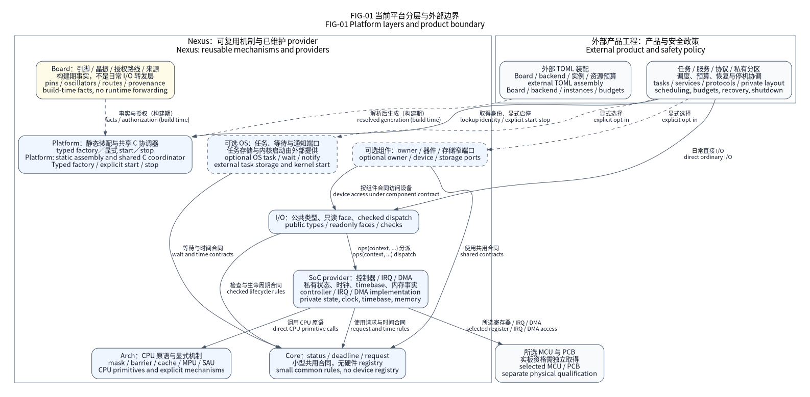

[可编辑 DOT](../assets/diagrams/platform-architecture.dot)。

## FIG-02 选定编译目标依赖

F407ZG 裸机 IRQ UART 的构建依赖；虚线为 include 使用要求或 OBJECT 注入。

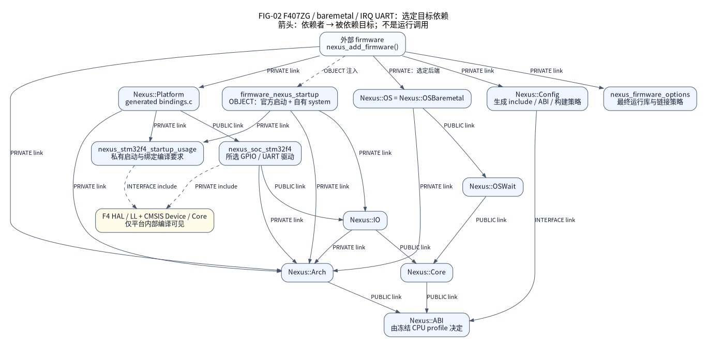

[可编辑 DOT](../assets/diagrams/build-targets.dot)。

## FIG-03 配置与原子生成

包声明、Board 与 TOML 沿同一输入快照进入通用政策与具名 IR，再形成有限静态连接
和原子 bundle。包只选择 CMake 入口，CMake 拥有唯一 C 源码图；失败不继续使用旧
输出或半成品。F4 的 `facts/` 与相邻领域 binding 通过 manifest 显式选择，全部
箭头表示构建期数据或产物依赖。

[可编辑 DOT](../assets/diagrams/configuration-generation.dot)。

## FIG-04 factory与静态实例

按需静态实例、强类型 factory、共享 ops 与独立 context；查询不启动硬件。

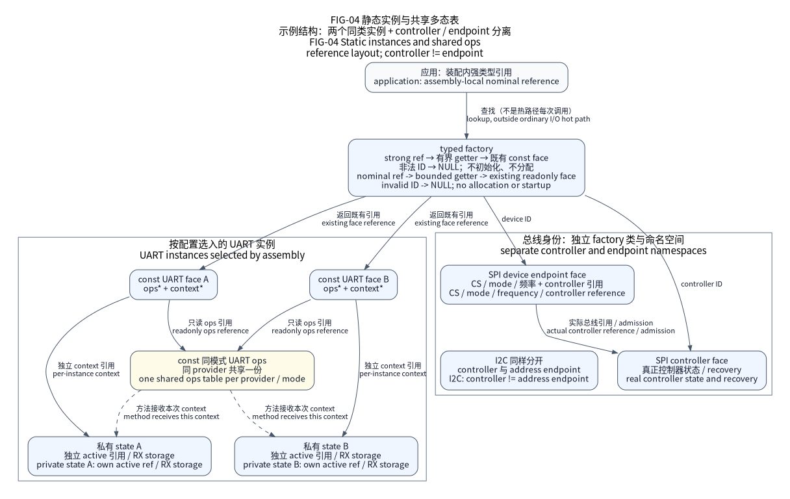

[可编辑 DOT](../assets/diagrams/factory-instances.dot)。

## FIG-05 显式启动停机与失败撤回

运行期由共享 C 协调器先检查上下文，再完成全部 controller 准入，之后才取得
System、共享资源与实例。共享资源／实例失败执行逆序回滚；System 启动结果分别
报告 primary、cleanup 和残效。释放失败保留具体 owner 收条与存储，不能超时强收。

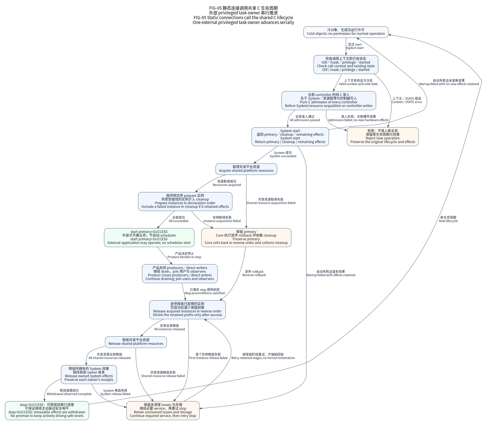

[可编辑 DOT](../assets/diagrams/platform-lifecycle.dot)。

## FIG-06 Core请求状态与借用

请求接纳、借用、排空和最终 SETTLED；取消不直接释放存储。

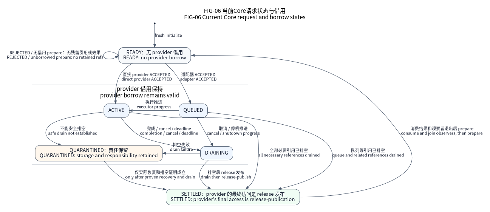

[可编辑 DOT](../assets/diagrams/request-lifecycle.dot)。

## FIG-07 UART与SPI有限DMA时序

选定 F407 有限 DMA 的内存完成、线上完成、撤回与发布顺序。

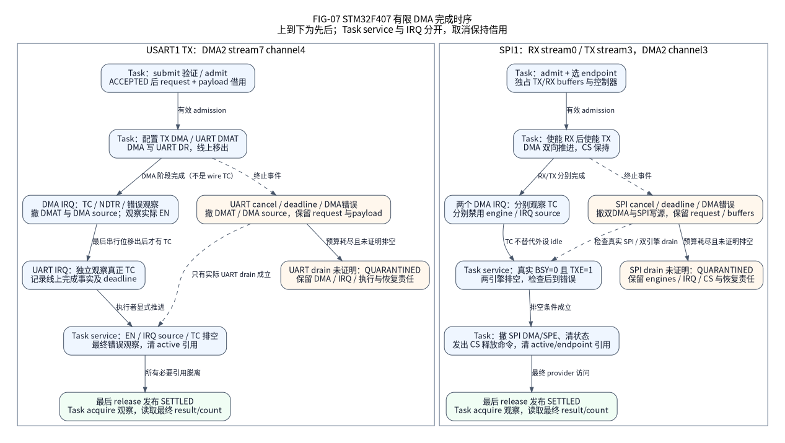

[可编辑 DOT](../assets/diagrams/dma-completion.dot)。

## FIG-08 wait wake与外部退出

等待、唤醒提示、执行进度与外部 join；通知不替代真实状态。

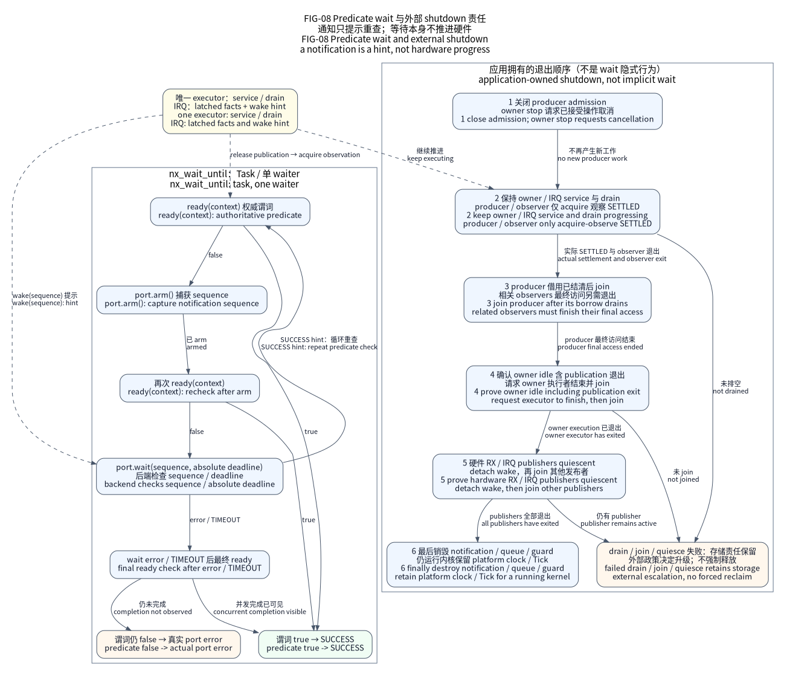

[可编辑 DOT](../assets/diagrams/wait-wake-shutdown.dot)。

## FIG-10 Source SDK独立消费

schema3 按所选 `profile.packages` 与包导出归属收集源码，不从单个 ELF 推导 SDK。
完整 prefix 可用于公开 GPIO 首工程或已有外部工程；实际编译仍由包内 CMake 负责。
主机运行、ARM 链接与物理 HIL 分别判断，图不授予软件候选资格。

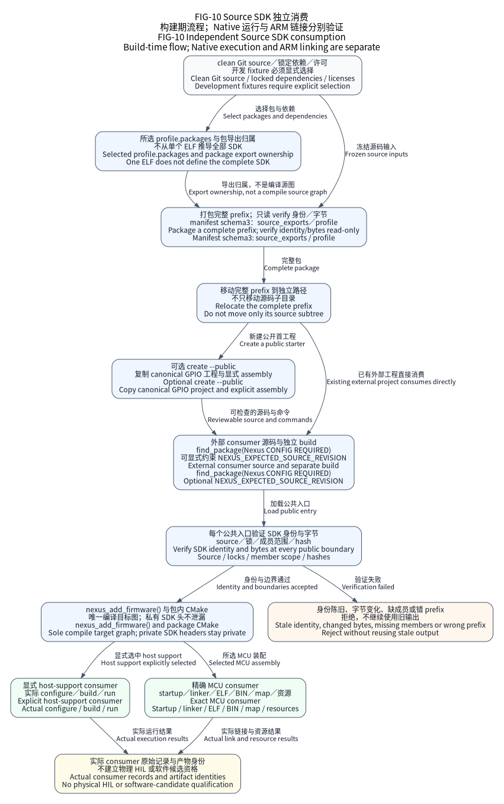

[可编辑 DOT](../assets/diagrams/source-sdk-consumer.dot)。

## FIG-11 软件与HIL证据关系

主机测试、ARM 链接、SDK 消费、HIL 工装和实板测量分别取得结果；每项绑定实际输入与产物，不能自动晋级。

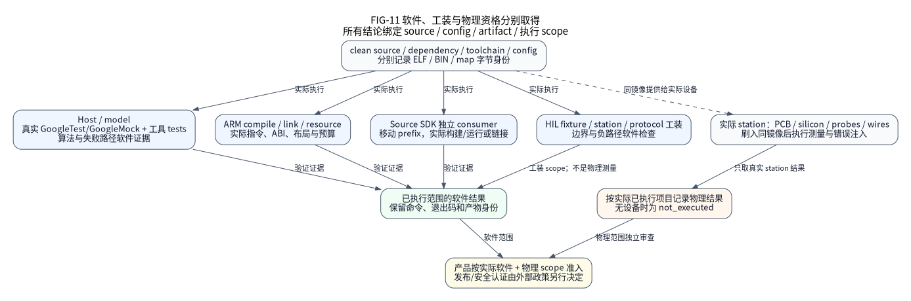

[可编辑 DOT](../assets/diagrams/qualification-evidence.dot)。

## FIG-12 文档、SDK 与实板验证边界

文档构建、独立 SDK 消费与实板执行各自记录结果，软件检查不自动建立部署或物理资格。

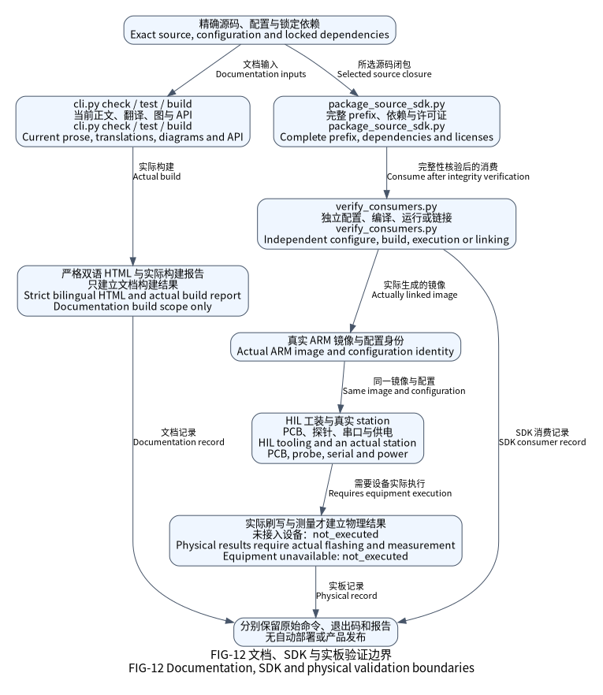

[可编辑 DOT](../assets/diagrams/verification-boundaries.dot)。

## FIG-13 Cortex-M能力分层

通用 CPU 原语与 Runtime 独立于当前 F4 SoC；CPU 名称不授予可选能力。

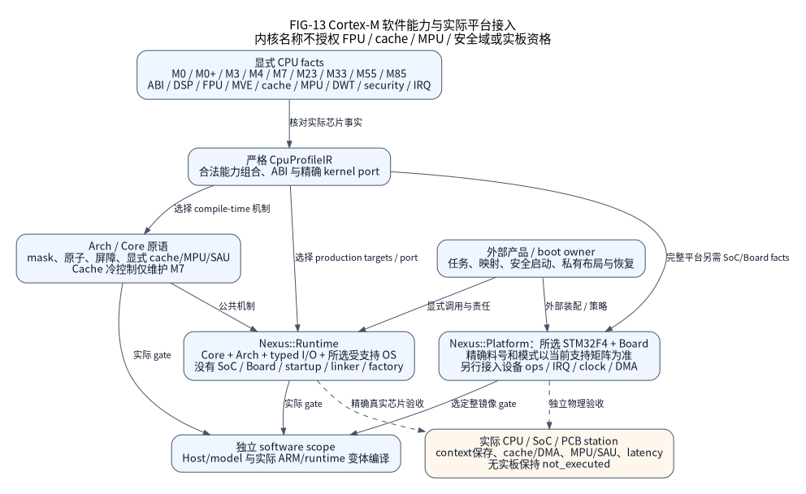

[可编辑 DOT](../assets/diagrams/cortex-m-capabilities.dot)。

## FIG-15 连续RX与可见丢块

选定 F407 连续接收的 producer、块借用、替换和 loss／停机责任。

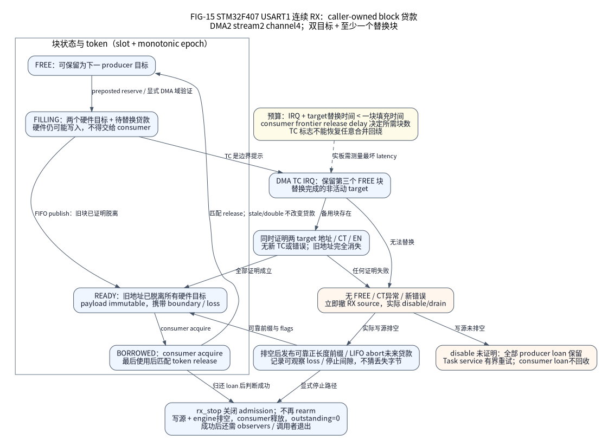

[可编辑 DOT](../assets/diagrams/continuous-stream.dot)。

## FIG-16 当前 I/O 装配与执行

构建期资源计划与运行时操作分开；不引入隐藏调度器或设备注册表。

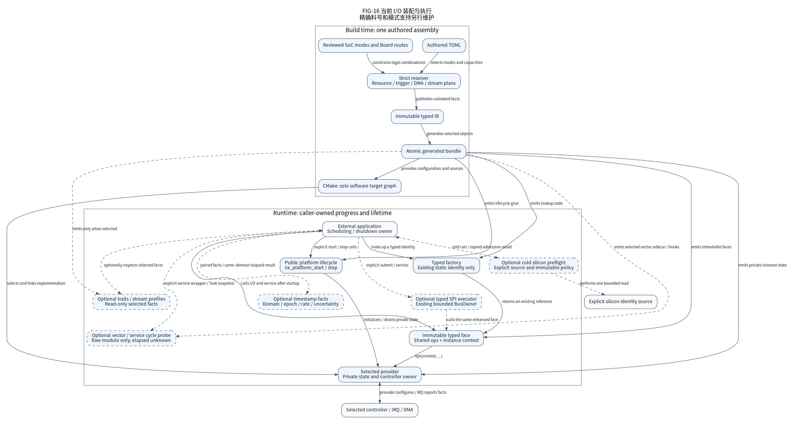

[可编辑 DOT](../assets/diagrams/io-evolution.dot)。

## FIG-21 Native RTC/LPTIM 装配、借用与重新开放

显式 Native RTC／LPTIM 主机测试；物理 provider 和低功耗不由模型推导。

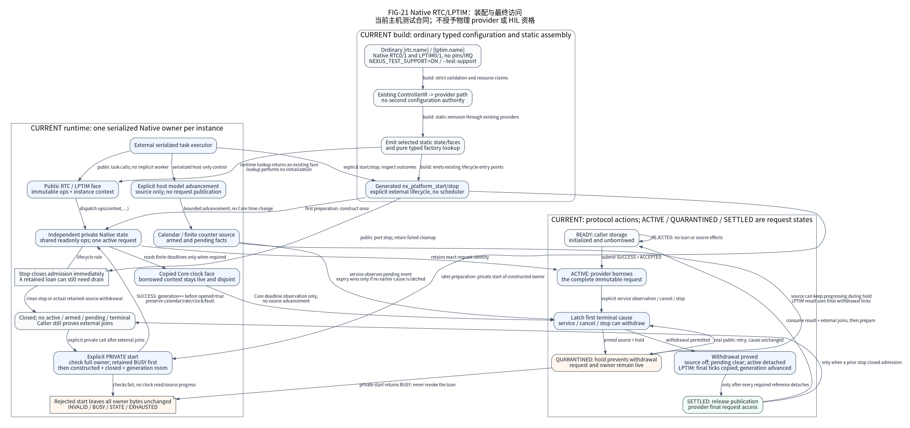

[可编辑 DOT](../assets/diagrams/rtc-lptim-lifecycle.dot)。

## FIG-25 UART TX 复制代理的 kernel 所有权与退出

公共复制 UART TX 代理的 owner、真实排空与退出；不授予硬件隔离。

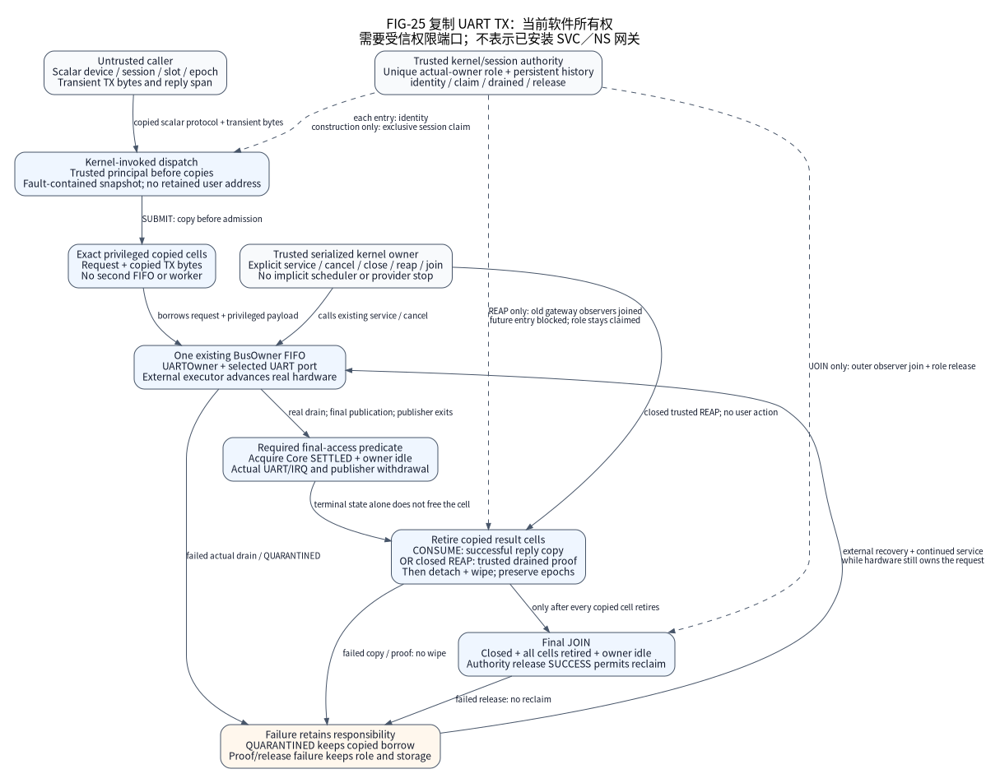

[可编辑 DOT](../assets/diagrams/user-io-copied-ownership.dot)。

## FIG-26 I3C 核心借用与整总线证明

公共有界 I3C 核心与借用合同；本轮没有生产 MCU I3C adapter。

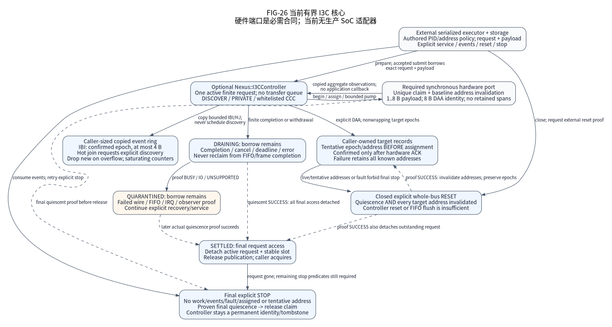

[可编辑 DOT](../assets/diagrams/i3c-core-lifecycle.dot)。

## FIG-27 统一 OS 源码接口的目标构建依赖

目标 task-profile 设计，尚未实现。箭头表示构建期依赖，包含编译依赖和链接时的
实现选择；每幅镜像选择一个后端，虚线表示可选扩展或按后端需要的依赖。
业务依赖公共接口，装配侧持有选定后端的静态布局；图中不增加运行时转发层、对象池或 worker。
设计与退出条件分别见[架构方案](../explanation/os-portability.md)和
[实施清单](../development/os-portability-plan.md)。

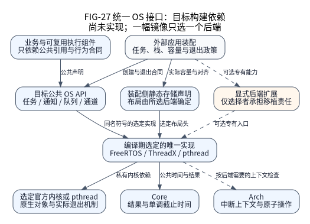

[可编辑 DOT](../assets/diagrams/os-portability-target.dot)。

## FIG-31 F4 源码归属与接口边界

包内 `facts/`、相邻 binding、Board 和 TOML 由通用配置器生成静态实例与固定连接。
`system/` 拥有系统与共享生命周期，`drivers/<domain>/` 拥有控制器行为，`sdk/`
选择私有官方库。虚线是构建／测试依赖，实线是公共 I/O 调用；图不增加运行时层，
也不把参考模型提升为生产或实板资格。

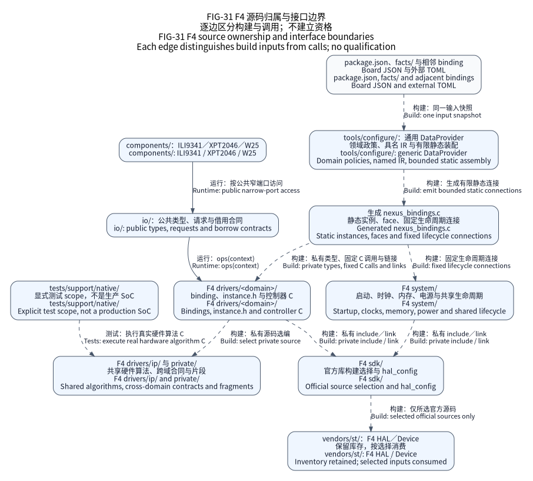

[可编辑 DOT](../assets/diagrams/driver-source-ownership.dot)。

## FIG-32 lwIP/TCP/TLS/MQTT 软件主机互通参考

主机 TCP／TLS／MQTT 互操作；不证明 MCU、SDK 或物理联网能力。

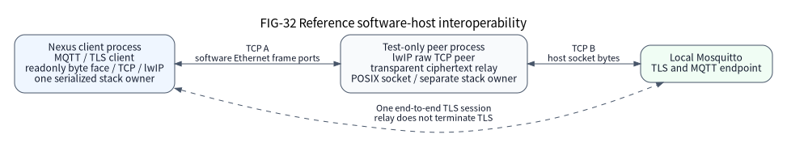

[可编辑 DOT](../assets/diagrams/lwip-tcp-tls-mqtt-host.dot)。

## FIG-33 当前运行时访问

factory 只查找既有静态接口；启动后普通 I/O 直接经共享 ops 与实例 context 调用具体实现。
owner、等待和调度为显式选择，不形成额外的必经转发层。

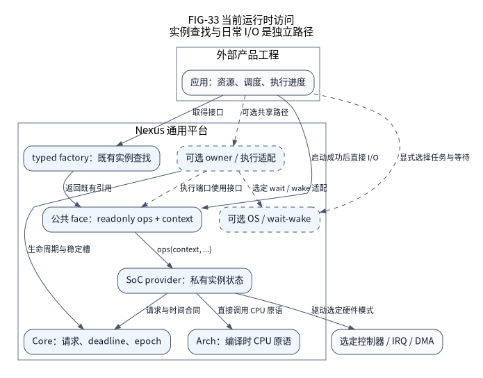

[可编辑 DOT](../assets/diagrams/platform-runtime.dot)。

## 图资源维护

每图维护 `.dot`、`.svg` 和 `.labels.json` 同名三件套，图索引完整登记。
标签文件使用 `schema_version: 1`、`en`、`zh_CN`；两种语言精确覆盖本图全部标签。
缺失、多余、重复或空白翻译均失败，不使用全局词典或未翻译回退。
原本为空的布局标签可以明确保留空字符串。

编辑后使用已准备的锁定工具生成预览并运行文档检查。Graphviz、字体和依赖身份
由工具环境校验；SVG 内嵌字形，拒绝外部资源和活动内容。正式构建在一次资产阶段
生成所选语言图，Sphinx 只读使用构建目录。不要在源码中维护另一套语言 DOT／SVG，
也不要把图源配对和渲染成功当成架构语义或实板验证。
