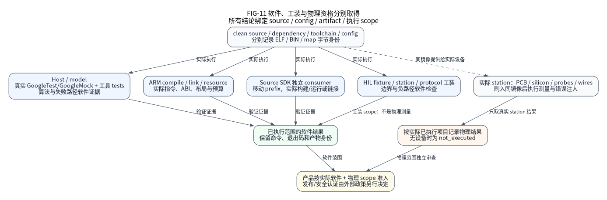

(reference.platforms.qualification)=
# 软件与物理验证边界

一个结果只适用于实际检查的源码、配置、工具、环境和产物。页面或代码存在不建立执行通过；公开 API、配置可行、Board 授权和真实运行也不能互相替代。

| 范围 | 需要的实际输入与观察 | 结论边界 |
| --- | --- | --- |
| Native/GoogleTest | 精确源码、选中模型/port、实际案例与新报告 | 所执行的软件合同 |
| ARM ELF/BIN/map | 真实编译链接、向量、配置、sections、资源预算 | 镜像与资源关联，不证明MCU已运行 |
| 搬迁 Source SDK | clean source、锁定依赖、许可/文件映射、独立C/C++消费者 | 公开include/ABI与实际构建/运行/链接 |
| 文档 | 当前正文、图源、对应译文、锁定工具、真实提取与构建 | 文档自身的内容和交付 |
| 物理 HIL | PCB/芯片/UID/probe/供电/station、同一镜像和负载、原始测量 | 被观察设备及已声明范围 |

## 源码、配置和产物一起读取

记录实际完整源码提交和 dirty 状态、作者配置与输入摘要、工具/依赖、命令、退出码、JUnit及镜像/资源身份。开发中的 dirty 运行保留真实状态；可发布 Source SDK 从 clean commit 导出并完成自己的字节与消费者检查。

软件结果不自动授予另一个配置、源码或产品。文档源码与被描述代码的身份分别记录；修改正文不会重新执行平台测试。相同版本号也不能替代相同字节、代际或ABI。

## 不完整与失败结果

空报告、skipped-only、陈旧输出、缺少原件、改动输入或中断运行不能作为完整通过。保留原始失败与后续重试，不把已失败的尝试改成成功。

描述复核、编译/链接、模型行为、物理路径和产品负载是独立维度。一个UART IRQ结果不能推导同板SPI DMA、另一个后端或任意负载。验收规则见[接入合同](../contracts/integration.md)，实际能力由[精确支持](support.md)与配置查询确定。

## 当前物理状态

当前 MCU 物理 HIL 为 `not_executed`。启动/时钟精度、IRQ/DMA时序、电气安全输出、Flash掉电、上下文保持、栈峰值、吞吐与功耗需要实际设备执行。HIL fixture、station template、预算或源码不能填补这些观测。

新实现运行其适用门禁并保留源码/配置身份。性能测量方法和物理工装使用[测量指南](../../guides/performance-hil.md)，产品负责负载、限值、签名、制造与现场发布政策。
