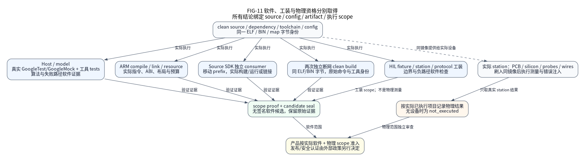

(status-software-verification)=
# 软件验证、源码身份与证据

本页导航已有执行记录，不建立本次文档 HEAD 的平台软件资格。必须同时比对
源码、装配、依赖、工具、实际执行与同一 ELF／BIN／map 字节，不能只看 passed。
资格规则由 [资格合同](../delivery/qualification.md)维护。

本轮 CF／EP／EV／MX／DX 32 项沿用[原执行 CSV](../design/developer-experience-execution.csv)与其[可读台账](ledgers/developer-experience.md)，实际结果从[现有结果索引](../delivery/developer-experience-results.json)的 `observations.configuration_workflow_20261106` 进入。代码门禁、SDK 消费、测量和严格双语文档分别绑定各自实际执行的源码、输入与原始收条；规划数量、历史计数和其他版本的成功均不作为本轮结果。软件资格与物理 HIL 仍按精确记录分别判断。

(p2-unsigned-software-ab532250)=
## 当前 P2 无签名软件交付与独立 QA 后续

本轮软件资格固定公共源码 `ab53225033dfb759e93c90beb6301a3048bbcfda`，tree
`2309ae92e019fac68c6f463cbee205c3726fe73d`，23 个公共依赖 clean。普通完整索引
门禁实际通过 420 个 Google 程序、7342 个用例和四个工具域合计 3964 个用例，
零失败、错误或跳过。两次独立完整 159 阶段计划均实际通过；每种 Native 模式各
420 程序／7342 用例／440 项 CTest，四模式计数不相加。tidy、cppcheck 各保留
1193 个编译上下文／1303 个自有 TU，实际返回 0。

SDK v15 的 64 个 root／67 个镜像／270 条命令及独立验证通过。H743／U575 ×
baremetal／FreeRTOS × empty／UART 的 8 个候选完成 16 次 fresh 断网构建，
各对 ELF／BIN 逐字节一致，seal、实际恢复和恢复后复核通过。四个 UART 的 HIL
仅为 `prepared_unbound`。精确 P2 严格文档完成 132 个 canonical 页面、264 条
reviewed 记录，Doxygen／gettext／EN／ZH、官方包及实际恢复复核均通过。

同 P2、工具和环境的完整计划比较保留每阶段原始成本与失败诊断。baseline／repeat
的阶段耗时累计分别为 6742.878869825／6387.338375682 秒，attempt interval-union
分别为 6742.710856041／6387.179537077 秒；它们是不同口径。最大观测进程 RSS
为 730820608／730624000 B，不能当作并发进程树峰值。缓存复用和存储迁位使本轮
比较属于 observational，`fresh_cold` 与 `controlled_causal_speedup` 均为 false。
F01 的 157 项同名检查及两个新增工具域、三个仅退休注册的原用例映射均保留。
N09 另有同一 CodeQL trace 内实际 fresh build directory configure/build 与 warm
configure/build，四份 compilation database 的 2642 条记录相同，warm 实际执行
15 次 compile／10 次 link；这不关闭其他 MCU、CLI 或 F05 的独立退出条件。

无签名公开交付从[固定的 12 片传输描述](https://github.com/X-Gen-Lab/nexus/blob/71b4f0e4cc9168e708513fb647b903c4bb39c71e/docs-public-p2-ab532250-20261104/transport.json)
取得。它绑定 401386855 B 的 outer archive；已独立 join、实际恢复 6657 个文件／
433814378 B，恢复当时，由同一 producer 及当时仍存活的资格产物执行 `verify-local` 通过。
先读恢复后的 `local-release.json` 查 archive/member 和原证据身份。远端包不含
全部 Native binary／object；42＋4 个本地 stores／fullindexes 保留完整可恢复
bytes／mode，不声明远端 Native 字节重建或自动重放原路径／nsmtime。
它为 `unsigned`、`local_observation_no_oidc`，未建立产品 Release、签名、hosted CI
或实板资格。

P2 Python 实际完成 174 个 query、45 条 finding 逐项处置。C++ 完成同一不可变
输入的跨 attempt 组合分析：109 项经完整解码验证的既有结果与 74 项实际补算，
随后 fresh full-suite interpret 返回 0；183 个 query 一一覆盖，1234 条原 finding
均逐项审查，无缺漏或重复。这不是单次 fresh 183，也不是零缺陷结果。原 OOM、
timeout 和取消尝试保留失败；Python／C++ DB 的 native 与 portable 实际恢复、
派生展开退休及临时 Native／TMP 回填分别保留收条，早期 live 字段不作当前存活声明。

真实发现的 Python FD 失败路径、GoogleTest `RE` 复制赋值及 lwIP fixture fatal
assertion 清理问题均有实际 RED／GREEN。机器依赖清单还修复了 official upstream
base 与 selected organization patch 的混淆。独立 QA 后续提交为
`706ee80b12a653a1820685c530b21e9668d82064`，tree
`5c39d9cfce75ed33354a13e1329c6e668b0463d2`；13-path 普通完整索引门禁通过
420 个 Google 程序／7342 个用例和 3968 个工具用例，零失败、错误或跳过。
其 GoogleTest pin 为官方 1.16.0 基线 `6910c9d9` 上的组织补丁 `58ec32c0`。
该新 SHA 已重新提取 Python DB 并实际完成全部 174 个 query：create／analyze
分别为 36.224848／96.868403 秒，均返回 0。38 条 finding 为 30 note／6 warning／
2 error；七条旧 finding 消失，其中两条为真实 FD 失败路径修复、五条为等价清理，
无新增或歧义匹配。剩余38条唯一对应原已审处置：其中36项所在源码的 blob 未变，两条变更文件
中的 survivor 已独立重读；两条 error 仍保留原严重度及准确源码身份的 Root 误报处置，
不称为零 error／零 finding。固件、C++ 分析、SDK、8 个候选和两次完整159保留 P2
身份，不转移资格；本轮未重跑第三次159。

当前私有 E 固定 `f59debf1a15913353462e69ba0039db1c010f284`，平台 pin 为 P2
`ab532250`。完整 17 presets／116 条维护 CI 命令均返回 0，Native 为 28 项 CTest／
18 个 Google 程序／204 用例，installed 为 2 项 CTest；各域不相加。source 与
installed 各五个真实 C broker 场景通过，deadline 的 exit code 4、缺 client certificate
的 exit code 6 均为预期拒绝，join／release／cleanup 实际闭合。三个 usage recipes 由本次
完整执行覆盖；公共安装版 SDK walk 完成 12 条命令及 1 项 CTest，SDK payload 与
origin 均未变。私有应用源码、payload 与原始日志保持私有，仅公开批准的聚合数据；
broker helper 的 `qualification=false` 保留，真实 C 用例与所有权清理另行核验。
首次 source broker 的 Docker bridge 环境失败保留，恢复原 docker0 后原维护 bridge
合同实际通过；不改写首失败。E 已在认证确认仓库为 private 后，正常 nonforce push 并精确读回同一 `f59debf1`；
private main 未更新，物理仍未执行。

后续 D 的独立双语审查／严格文档包／恢复、真实部署读回和最终 FF 仍须分别绑定
实际文档源码。服务端规则的原 403、Release 上传的原 401 均保留。物理 42 项仍为
`not_executed`；Flash／ECC event-owner／sticky 边界、七组 vendor-leaf 提案和 GD303
引用审查不因本轮软件通过而关闭。完整数据与取得边界见
[同一结果索引](../delivery/platform-delivery-completion-results.json)的
`source_version_records_20261103.final_public_source_P2_ab532250`。

## 历史 eb4 开发记录与恢复进度

该历史阶段接受的公共开发源码为 `eb4aba660df27b6ecedf52fcb13dc1c95652ca0d`，
tree 为 `7586629e789ab5e7cb12cff8609694c04d684a09`。其普通完整索引 Native
Debug 门禁实际通过 420 个 Google 程序、7335 个用例和 3950 个工具用例，
零失败或跳过。I/O 性质报告记录 233 条有界执行性质，并另列 8 条 unproven；
未证明项不计入已执行数。这些范围不相加，也不代表完整 159 阶段正式计划或新候选。

此前 `6c3a380a` 的 clean Source SDK v14 已实际完成 59 个 root、62 个镜像、
246 条命令及独立 SDK 校验，clean 中英文构建也曾实际完成。中断后部分 TMP／SHM
原 receipt 副本丢失；保留的普通门禁归档 `f8da57a5…cca7` 和 SDK 归档
`db2576f7…c41f` 仍按原身份定位。本次仅核对这些归档的原 SHA-256／bytes，
不补造丢失原件，不声称重新执行 v14 校验。完整摘要、原恢复记录与取得边界见
[同一结果索引](../delivery/platform-delivery-completion-results.json)的
`source_version_records_20261103`。

当前组合包括 RX 负载借用、MCUboot 控制、TX 错误观察、PCAP、resolver／CLI
改进和 SDK v15；普通门禁已按上述源码实际完成。安装版 SDK 的完整 64 个 root／
67 个镜像、独立验证与归档核验进度，由同一结果索引的当前精确源码记录分别
说明。早期 TLS 205 项定向检查、NativeBoard 模型专用的 FLASH=0 准入和
resolver RED→145 项 GREEN 保留原开发范围，不替代当前源码的实际记录。

恢复后的 F407 联网开发参考已链接：全部 217 个实际 C 编译单元有效选择 `-Os`，
无 LTO，Flash footprint 为 134304 B，总 SRAM 为 116024 B，libc heap 为 0 B。
它超出固定 MCUboot 128 KiB 参考槽的 129536 B payload 允许量 4768 B；没有
镜像可容纳承诺。五个真实 host broker 场景和十个 PCAP 另属主机协议范围。
这些结果不证明实板 PHY／DMA、可信 UTC、物理熵、性能、栈峰值或新软件候选。

私有示例的旧基线 `2e932bbc`（PR 24）固定 SDK `7fd36f8a`，其普通门禁为
86 个 Python 用例、23 项 CTest、13 个 Google 程序和 146 个用例。后续已接受
私有开发提交 `ff86eb49` 固定公共 SDK `6c3a380a`；其普通门禁为 89 个 Python
用例、28 项 CTest、18 个 Google 程序和 204 个用例，source 与 installed 各执行
五个真实 broker 场景，均零失败或跳过。该私有范围与公共 `eb4aba66`／v15 分开。
早期 peer 11、main 4、broker 5 和 24 个文件 style 检查保留原源码范围，不与
新执行相加。公开平台仅记录聚合与提交／PR 元数据，私有源码、payload 路径、
receipt 和归档保持私有；当时 PR 24 仍为 draft。

本节 `eb4aba66` 历史记录当时没有完整计划、fresh 离线复现或新的固件候选。
`v0.2.1` 与 `7590b2d4` 的原执行不变；后来的 P2 资格与 QA 后续见上方当前节，
服务端规则和 HIL 仍按各自原退出独立验收。

(sdk-preview-v021)=
## 0.2.1 软件预览：b1b903da

公开 [v0.2.1 Release](https://github.com/X-Gen-Lab/nexus/releases/tag/v0.2.1)
固定平台源码 `b1b903da47eda722a6be3e98edced5cfa36221b1`，tree
`56fc077ca7048d4758bdc050a98046de77824d08`。它是软件预览，不是新的正式软件
候选、生产资格或物理 HIL 结论。发布后源码继续迭代时，不继承本节的实际执行。

| 范围 | 取得入口与实际界限 |
| --- | --- |
| 精确源码 CI | [平台 CI](https://github.com/X-Gen-Lab/nexus/actions/runs/41397178941) 的 31 个 job 与 [Security](https://github.com/X-Gen-Lab/nexus/actions/runs/41397178889) 的 4 个 job 实际成功；不替代完整候选计划或物理测量 |
| Source SDK | [维护的 manifest](https://github.com/X-Gen-Lab/nexus/releases/download/v0.2.1/source-sdk-manifest.json) 与 [SDK 归档](https://github.com/X-Gen-Lab/nexus/releases/download/v0.2.1/nexus-source-sdk-0.2.1.tar.gz)；policy-v11 的 50 个 consumer root、53 个镜像和 202 条命令实际通过，不扩大成其他组合资格 |
| Release | [实际发布流程](https://github.com/X-Gen-Lab/nexus/actions/runs/41402947612) 上传 13 个资产；[发布清单](https://github.com/X-Gen-Lab/nexus/releases/download/v0.2.1/release-manifest.json) 绑定其字节，`v0.2.0` 旧标签保持原身份 |
| 中英文文档 | [实际 Pages 部署](https://github.com/X-Gen-Lab/nexus/actions/runs/41403026859) 与 [文档 manifest](https://github.com/X-Gen-Lab/nexus/releases/download/v0.2.1/documentation-manifest.json) 描述同一 `b1b903da` 源码；站点后续更新以实际 manifest 为准 |
| 正式候选与物理 | 本预览没有建立新的软件候选；实板状态仍为 `not_executed`。历史候选见下方原封存基线，OCI recipe 与服务端规则分别按实际结果判断 |

新一轮 [71 项规划入口](../delivery/next-iterations.md)映射至同一原交付台账。
新增功能、配置或依赖必须取得自己的实际回归、SDK 和候选记录；导航整理本身
不关闭软件、物理或服务端规则退出。

## 当前开发源码的 SDK 消费计划

维护源码的 `nexus-sdk-consumers-v16` 保留 v15 的全部精确选择，增加标准 Native
外置 provider 生命周期工程，要求 65 个独立 root、68 个镜像。选择由
[同一计划权威](../../tools/release/transport.py)定义；计数是计划结构，不是执行
receipt。已发布 `v0.2.1` 的 v11 与已接受 `6c3a380a` 的 v14 保持原身份。

新工程来自 [唯一的 C11 接入示例](../guides/provider-porting.md)，实际执行静态
实例的取得、启停、失败回滚和保留后的清理。它不建立新 MCU／PCB 或物理资格。
完整的当前计划执行结果必须绑定自己的 clean 源码和原始 report；旧版本的执行
不自动覆盖新增工程。

### v15 的五个已有 profile

| 新增 profile | 计划消费范围与界限 |
| --- | --- |
| `f407 loaned rx` | F407 C11 负载借用与显式 Storage/profile 外部链接；物理 MAC／PHY 和完整 SRAM 另验收。 |
| `gd470 loaned rx` | GD470 独立 ARM 上下文验证相同选择，不继承 F407 执行或物理结论。 |
| `native mcuboot control` | Native 模型显式 operation 绑定与永久请求读回；不代表实板 Flash 或启动。 |
| `f407 mcuboot control` | 应用侧通用 Control 与具体 Flash Port 显式装配，不链接完整 boot 内核。 |
| `f407 mcuboot boot` | 独立 boot／payload 镜像及参考布局链接；产品分区、信任和物理恢复责任不自动闭合。 |

五条新增 consumer 已在两个不可发布的开发前缀取得实际观察：两条 loaned-RX 位于
`188d1b54` snapshot，三条 MCUboot 位于 `e2ac91bd` snapshot。它们保留各自的
源码与失败／成功范围，不能合成一次 clean 64／67 执行。完整 producer report、
独立 SDK verifier 和归档核验以同一结果索引的当前精确源码记录分别解释，
不使用开发前缀或计划计数代替接受结果。

安装版 SDK、严格双语文档和私有后续执行的当前接受状态，均由上述结果索引的
精确 source-version 记录给出。文档记录绑定实际 clean 源码、四条构建命令和
可恢复的 HTML／receipt 归档；后续状态文字检查不能冒充原 HTML 构建或固件资格。

## 三种身份分别解释

下面字段用于成功打包的正式站点与离线包。构建预览先查看
`documentation-build.json` 的 `source`、状态和原命令 receipts；预览尚没有正式
`documentation-manifest.json`，也不据此声称发行完成。

| 身份 | 取得位置 | 含义 |
| --- | --- | --- |
| 当前代码源码 | 站点 `documentation-manifest.json` 的 `code_source` | 本站描述的 checkout、tree、dirty 状态和代码路径 |
| 当前文档源码 | 同一 manifest 的 `documentation_source` | 本次正式文档包的精确 commit/tree；不替代预览构建记录 |
| 被引用资格源码 | schema 2 manifest 的 `qualification_references[]`；每项保存原候选身份与 scope | 旧的精确代码执行；不是当前代码／文档 HEAD 自动继承的资格 |

成功打包后，公开站点和离线包的 manifest 由实际构建输入生成。Git HEAD 可以因文档提交改变；
这里不手填一个很快漂移的 HEAD 常量。未打包的工作树可执行 `git rev-parse HEAD`
核对 checkout，但命令输出本身不是 qualification receipt。

schema 2 不再隐式引用某个历史索引。打包者逐个显式选入原封存候选，工具调用
同一候选 verifier 核对原始闭包后记录 source、configuration、ELF／BIN／map、
qualified scopes 与候选文件摘要。没有选入候选时列表为空，不表示软件失败。
文档包离线校验保护这份引用的字节和结构，不重新执行或代替原候选资格校验。
原 locator 只说明当时的存储位置，不是公开下载地址。schema 1 历史包保留原
`qualified_code` 的只读校验，不能用它生产新的默认资格引用。

(sealed-cold-lifecycle-baseline)=
## 最终冷态生命周期交付：7590b2d4

本节描述已完成的封存基线，后续代码与文档提交不自动继承它的资格。平台
`7590b2d457d6042112abb78a4f4df74d613df6ff`，tree
`17c18aea10066d5d7418f3a7fd3b42e619ee3414`，已通过
[PR 41](https://github.com/X-Gen-Lab/nexus/pull/41)合入原 `main`，没有另造
源码合并提交。对应外部示例为 `b029cc4b7e8e7a7d3e5e1f1be080a0aa24b1ee09`，
其固定 SDK gitlink 为上述平台提交；[示例 PR 18](https://github.com/X-Gen-Lab/nexus-examples/pull/18)
已合并。示例仓库当前为私有，平台的公开访问权限不包含示例访问权限。

公开的[平台交付索引](https://github.com/X-Gen-Lab/nexus/blob/ecb86832fced0192d620b9029ff2d54795fc6430/docs-platform-delivery-20261029-g7590b2d4/final-index-g7590b2d4.json)
固定于证据提交 `ecb86832fced0192d620b9029ff2d54795fc6430`。
先读取同目录的 `public-recovery-proof.json`：初始 payload 索引保留上传当时的
观察，恢复证明记录其后实际下载、摘要核对和独立恢复的结果，不能把初始
`pending` 当作最终结果。二者均保留原始字节，不相互改写。

| 范围 | 实际完成与界限 |
| --- | --- |
| 正式软件计划 | 同一 clean 平台源码的 159 个维护阶段全部实际通过；owned verifier 通过。原执行报告的 `software_qualified=false` 保留，计划通过与候选封存分别判断 |
| Native 四模式 | Debug、Release、ASan/UBSan、TSan 各执行 406 项 CTest、386 个 Google 程序、6819 个用例，零失败、错误或跳过；四个工具域共执行 3481 个 Python 用例，不与四模式重复相加 |
| 静态分析 | Clang-Tidy 与 Cppcheck 各分析 1135 个不同编译上下文；这是软件分析，不能替代当前源码的 CodeQL 关联或物理测量 |
| Source SDK | 50 个独立 consumer root、202 条命令及维护的精确 policy-v11 选择实际通过；53 个完整策略镜像由原计划逐项约束，不能仅凭计数替换选择 |
| 八个软件候选 | H743 HSI64/Cache off、U575 MSIS4/TZEN=0，各取 empty/UART 与裸机/FreeRTOS；16 次 fresh、断网构建及候选封存、校验和恢复完成，不扩大为高级 DMA/Cache/低功耗模式资格 |
| 中英文文档 | 原平台源码的 132 页、264 个语言记录、严格 API/gettext 构建、离线打包和独立恢复完成；文档包没有隐式候选引用，实际 Pages 部署仍未执行 |
| 远程证据恢复 | 本轮 335 个公开 payload member 的精确提交下载、SHA-256/bytes 核对完成，90 个原归档均独立恢复；原始失败和中断观察仍保留 |

候选封存原外层执行会话曾丢失，原外层 receipt 保持 `running/null`；24 个已结束
子命令及后续独立恢复证明各自真实完成。不能补造外层 exit 0，亦不因此丢弃
已经完成的子命令原件。合入主线仅执行身份与固定依赖同步，没有重跑或冒认新的
软件计划、构建或封存。

示例的[授权恢复入口](https://github.com/X-Gen-Lab/nexus-examples/blob/1baac7b7946a3d71e855e41365972b0781af5291/docs-examples-delivery-20261029-gb029cc4b/recovery-index.json)
固定于私有证据提交 `1baac7b7946a3d71e855e41365972b0781af5291`。使用已有
GitHub 仓库授权读取，不向公开平台归档复制示例源码、私有执行报告或归档。
没有示例权限的读者可使用公开 Source SDK；私有链接无法访问不表示平台恢复失败。

### 封存时尚未关闭的退出

| 工作 | 仍需实际执行的验收 |
| --- | --- |
| 三板 HIL 与性能 | 接入真实 station，执行启动、时钟、UART、DMA、停机、恢复，再测 IRQ 延迟、吞吐、功耗和栈峰值；目前均为 `not_executed` |
| OCI recipe 与新 daemon | 按锁定 recipe 独立完成两次 fresh 构建，并在新 daemon 实际 load/inspect/run；现有 OCI 字节恢复不建立 recipe 可复现性 |
| CodeQL、Pages 与服务端规则 | 取得当前源码的实际 CodeQL 结果及处置，实际部署并核对 Pages，以及服务端回读分支规则；本地门禁不代替这些事实 |
| 高级外部使用路径 | 7590 基线的 H743 Flash/RAM、U575 retained-time/Stop2 仍需独立外部 recipe；已有 C 机制与 SDK 链接检查不等同于完整使用教程或实板执行 |
| 历史示例证据边界 | 对既有公开示例证据逐项分类后决定保留、迁移或撤回；元数据清单不代表已审查所有归档内容，尚未改写历史 |
| 正式 Release | 明确本地 CI 的可信准入并执行发布；不伪造 Actions run，也不把无签名软件候选当作产品发布 |

当前 firmware 的硬件算法全部保留在维护的 C11 路径；Python 负责严格配置、静态
对象和固定调用装配。后续迭代优先改进上述使用、交付与实测闭环，不能从这份
封存摘要推导“全系列、全部外设、所有原退出已完成”。

## 后续维护观察：2026-10-30

本次维护从上述平台和示例基线分支继续。[现有 78 项台账](../design/platform-delivery-completion.csv)
只更新已有证据能够证明的状态与索引，并通过原 renderer 派生[可读视图](ledgers/platform-delivery-completion.md)。
全部原编号、顺序、退出条件、物理状态、历史 Git 版本、原报告与候选字节保持；
状态分别绑定原受测源码。正式资格仍属 `7590b2d4`，后续开发执行单独记录，
不以新文档 HEAD 覆盖资格源码，不能把该基线的 159 阶段结果重标到新源码。

平台增量 `dee8be5bb1052442a7853cf792b3fd589e17a9c9` 的普通完整索引门禁
实际通过：3565 个 Python 用例（testing 1755、configure 1156、CI 493、workflows
161），以及 386 个 Google 程序、6819 个用例，零失败或跳过。这是该提交的开发
门禁，不是新的完整 159 阶段正式资格，也不扩大旧候选范围。

私有示例后续提交 `ac9f07ba7494f472144f37660aabbd4185710394`（[PR 19](https://github.com/X-Gen-Lab/nexus-examples/pull/19)）
与 `5fb06175aab72292fb075e8a9ea67096203a86dc`（[PR 20](https://github.com/X-Gen-Lab/nexus-examples/pull/20)）
均已合并；示例当前主线为后者，SDK gitlink 仍固定已验证的 `7590b2d4`。最后普通
门禁实际通过 85 个 Python 用例、21 项 CTest、12 个 Google 程序和 129 个用例，
零跳过。H743 Flash/RAM 和 U575 retained WUT、SRAM4 copy、LPTIM1 单组 LPBAM
已有独立工程、实际 ARM 链接与资源检查；H743 的 RAM 执行闭包亦经审核。这补齐
E04 当前维护的选定高级 recipe，属于软件开发执行，不代表 HIL、通用 LPBAM、
新平台正式资格或新的软件候选。

初始 LPTIM 草稿早于对应测试的事实已在 PR 20 披露；后续真实 RED → GREEN
修复保留原执行。不用重建的源码补造早期测试顺序。并行 TDD 现要求测试 owner
先保留实际 RED、源码与二进制，再释放实现 owner 的交接屏障。

| 退出 | 本次实际观察 |
| --- | --- |
| GitHub 分支规则 | 写入仍返回 HTTP 403 `Resource not accessible by integration`；规则回读为空，不能声称保护已启用 |
| CodeQL 关联 | 当前 API 读取返回 HTTP 403；未取得可处置的当前源码扫描结果 |
| Pages 部署 | 尚未实际部署；本地 HTML 和归档恢复不代替远端站点核对 |
| OCI 重建与新 daemon | 可用容量未满足既有准备估算，尚未启动两次 fresh recipe 构建或新 daemon 执行；旧 OCI 字节身份及不等价边界保留 |
| 首发三板工装 | 三板 prepare 与 measurement plan 共六条 CLI 实际返回 0，状态仍为 `prepared_unbound`；实板采集和性能测量均未执行 |
| 历史发布边界 | 私有留存与当前公开分支 tip 的 21 项 member 撤下已实际完成；旧提交、缓存与 clone 仍可能保留原数据，未改写历史 |

这些外部退出保持开放，软件实现继续推进。规则写入失败的原命令与诊断位于
执行主机的 `build/completion-20261030/remote/`；这是原主机定位，不是公开下载
URL。需要当前完整记录时，先核对后续提交的实际交付索引，再按其固定身份恢复。

历史发布边界的实际处置见[公开撤下说明](https://github.com/X-Gen-Lab/nexus/blob/d14d093879362d6a1796ee9e0d47f75f793e5135/docs-asset-retention-20261030/WITHDRAWAL.md)。
私有留存的[授权恢复索引](https://github.com/X-Gen-Lab/nexus-examples/blob/8aa825c7d2cd8f58f4fa84869f16700aea400783/docs-legacy-examples-retention-20261030/retention-index.json)
固定于 `8aa825c7d2cd8f58f4fa84869f16700aea400783`。本次正常 hook、非强制推送、
精确提交回读与成员核对已执行；未改写旧提交，不把当前 tip 撤下称作历史擦除。
当前 `7590b2d4` 平台恢复证明与示例私有 `1baac7b7` 入口仍保持原身份。

F04 的结论保留原审查的合同／oracle 映射层级，不扩大为全项目每个历史用例
均已人工证明语义独立。真实硬件、完整受控 cold/warm 对比与环境重建等原退出
仍由同一台账保留，不能因完整软件计划已通过而批量改成完成。

## 历史独立结果索引

| 范围 | 精确代码源码 | 原权威及执行说明 |
| --- | --- | --- |
| C 冷态与工程交付增量 | `194ca6cb`；`d21dfcab`；`364f3665`；后续工作树分别记录 | [同一结果索引](../delivery/platform-delivery-completion-results.json)的 `current_iteration_20261028` 保留各自源码、普通门禁、ARM、SDK、文档和归档；[原 64 项退出](../design/platform-delivery-completion.csv)没有缩减。开发结果不代表最终合并源码的完整资格 |
| 组织托管依赖与受控交付 | N2 `ce616ea9b30fd2bbd9511f73e2f3b5d8028224b4`；E1 `cef24bd1c7bc500fb28a17a6e1ff9cc7d5511711` | 原正式软件计划 159 阶段通过；外部示例 98 条命令通过；精确配置候选的六个 scope 已通过，原候选仍无签名，物理 HIL 未执行，产品晋升未执行 |
| 类型化 IR、冷态接入与交付统一 | P2 `fc01d863c3374643c276195ae19a24e6f8b8c8ee`；E `acb5179ec09e0c2fae1911d32655296df39acedc` | [精确执行说明](../delivery/verification.md)；Q02 完整 159 阶段通过，E 完整本地执行通过；精确配置候选及六个 scope 已通过；Q01 失败单独保留，远端状态发布未确认，物理 HIL 未执行 |
| SoC/IP 目录整理与原候选 | P `92e669233957a2e450a528394e8f4dd0794c7049`；E `0f15022e4d5f5c51991b134d0b9d6082dcf88de9` | [执行说明](../delivery/verification.md)、[48 项原台账](../design/soc-ip-layout-execution.csv)、[派生视图](ledgers/soc-ip-layout.md)；同一 P 的 A90＋B69 分段覆盖，原候选只覆盖其精确配置，物理 HIL 未执行 |
| 开发体验迭代 P 与示例 E | P `c8df1c49d4f771a55490b3a8be32a9d1f24faa1e`；E `acb923cae407c8cfc4ac5788f8026d35c84cc841` | [结果索引](../delivery/developer-experience-results.json)保留本地完整 gate、SDK 独立消费、示例 ARM 和原始归档；不是正式软件候选 |
| 构建系统及其实际软件 scopes | `cc6a065c002041234a212a964be863a69198f9b4` | [结果索引](../delivery/build-system-results.json)、[执行记录](../delivery/build-system-verification.md) |
| SoC 扩展软件切片 | `98270512ea2ff7eefe8ff79720018e582be3a949` | [结果索引](../delivery/soc-extensions-results.json)、[执行记录](../delivery/soc-extensions-verification.md) |
| 较早 SoC refinement 基线 | `3728b334b02eb2eb70bcf5d4caafbb9746837dd3` | [结果索引](../delivery/soc-refinement-results.json)、[执行记录](../delivery/soc-refinement-verification.md) |

N2/E1 的原本地候选导航分别记录在外部示例仓库的
`build/controlled-dependencies-ce616ea9/delivery-index.json` 和
`build/documentation-controlled-dependencies-ce616ea9/delivery-index.json`。
前者定位原候选、产物与可移植证据；后者定位双语文档包和独立离线恢复记录，
文档发布仍为 `published=false`。这些路径是原主机留存位置，不是公开下载 URL。
Nexus 合并提交 `3ea252c6` 与受测 N2 的 Git tree 相同，示例合并提交 `4a9f5f75`
与受测 E1 的 Git tree 相同；关联保留原受测提交，不改写候选源码。本次后续 C
生命周期增量中，`194ca6cb` 已完成其精确源码的 SDK 消费与严格双语文档交付；
`d21dfcab` 已完成其普通完整索引门禁。该索引中的后续 pending 字段属于当时的
开发观察；最终 `7590b2d4` 的门禁、SDK、示例、文档、双构建与封存见本页前节。
各家族开发计数不可相加，也不覆盖四种 Native 模式或实板验收。

各索引保留原 schema、范围、失败尝试、receipt、归档和 member 身份，不能相加
测试次数、ARM 镜像数或任务数量，也不能据此计算全项目完成率。后续文档 commit
只记录这些基线。当前文档的检查、渲染、离线恢复与部署验证各自有独立记录。

构建系统记录没有执行一次完整 72-stage 软件总计划，也没有执行 OCI recipe 重建、
CP311 离线安装、Windows/macOS 集成或 MCU HIL。独立执行过的具体 scopes 按原索引
解释；不要从其 aggregate 状态扩大结论。其八个无签名软件候选是 H743 HSI64／
Cache off 和 U575 MSIS4／TZEN=0 的 empty／UART、裸机／FreeRTOS 组合。

## 如何取得与核对旧证据

1. 先打开对应结果索引，确认 canonical code commit、配置和记录 scope。
2. 使用索引中的归档定位，核对归档 SHA-256 和 bytes；记录失败尝试的原身份。
3. 根据 `archive_relative_path`、`archive_member_relative_path` 等原字段定位 member，
   继续核对该 member 的 hash 和 bytes。字段名因原 schema 而不同，按该索引解释。
4. 查看实际执行记录、原始日志和同一产物。软件模型、链接、独立消费和两次断网
   重建分别证明自己的范围，某一类成功不替代另一类。
5. 物理记录按 [HIL 状态](hardware.md)另行判断。

原 `/workspace/...`、`/dev/shm/...` 是执行主机定位，离开该主机不能当作公开下载。
构建系统索引的 `evidence_navigation` 明确候选归档、candidate document、ELF／BIN／map
和全部 member 清单的定位方式。归档当前是原记录的本地留存；没有发布的远程证据
不能伪造下载 URL。文档包包含原 JSON 以便核对，并不复制大型原始归档或重签历史字节。

FIG-11 表达资格关系，不生成 receipt。标准与图源依据见 [图册](../assets/diagrams/README.md)。
逐项原退出条件见 [台账视图](ledgers.md)。
