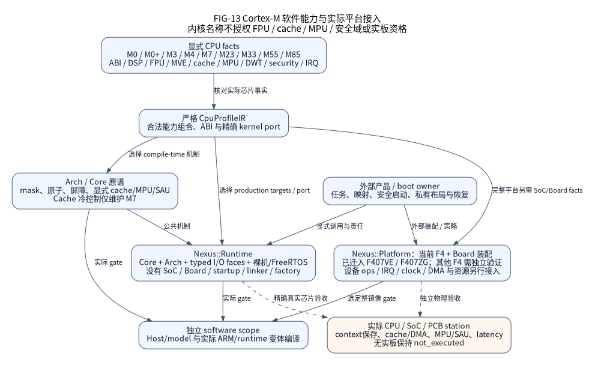

(status-support)=
# 支持范围与选型

当前生产入口只有 STM32F4，具体实现限定 F407VE／ZG 与四个独立 Board 包。
[支持参考](../reference/platforms/support.md)说明选型方法，
[详细支持](../delivery/support.md)限定模式，
[派生矩阵](../delivery/capabilities.md)关联事实、路线、夹具和生产定义。

使用前分别核对精确料号、板级接线、所选实现、软件执行与物理结果。配置可解析不代表
软件候选，厂商 SDK 保留不代表生产支持。Native 是显式测试支撑，CPU-only Runtime
也不生成具体 SoC、Board 或 factory。

软件结果须匹配源码、配置、工具和实际产物；当前重构不继承
[原版本记录](https://github.com/X-Gen-Lab/nexus/blob/8e147fc2c812d81ab6596e0d1a6bc8908d30ac18/docs/status/software-verification.md)。
真实硬件还需 [station 原件](hardware.md)，当前物理 HIL 为 `not_executed`。

