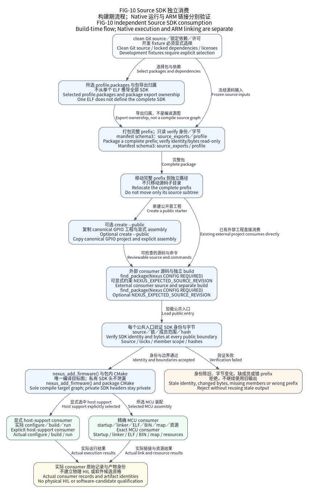

(docs-tutorials-source-sdk)=
# Build an independent Source SDK consumer

Start a real external C11 application from a reviewed template, then build and
run its Native model. This path needs Linux, Python 3.11+, CMake 3.31+, Ninja,
a C compiler and Git. The product owns its assembly and application sources;
Nexus owns reusable mechanisms. No MCU is flashed by this tutorial.

## Create and run an application

Obtain a verified Source SDK and the external
[nexus-examples](https://github.com/X-Gen-Lab/nexus-examples) checkout. That
repository is private and requires its own GitHub access; public Nexus or SDK
access does not grant template access. The independent SDK verification below
does not require that private repository. Set
`NEXUS_SDK_PREFIX` to the installed SDK prefix, `NEXUS_EXAMPLES_DIR` to that
checkout and `NEXUS_EXAMPLES_REVISION` to the exact 40-character examples commit
recorded with the chosen platform delivery. Set `NEXUS_EXPECTED_REVISION` to
the exact 40-character platform commit from that verified delivery. These are
separate identities: the template's expected platform revision does not prove
which SDK was used. Run these commands from
`$NEXUS_SDK_PREFIX/share/nexus/src`; choose a new product directory outside both
input checkouts:

```sh
: "${NEXUS_EXPECTED_REVISION:?select the reviewed platform commit}"
python cmake/package/package_source_sdk.py \
    --verify "$NEXUS_SDK_PREFIX/share/nexus/src"
python tools/dev/dev.py create --templates "$NEXUS_EXAMPLES_DIR" \
    --revision "$NEXUS_EXAMPLES_REVISION" --template native \
    --sdk-prefix "$NEXUS_SDK_PREFIX" --output /tmp/my-nexus-product
```

Creation reads committed template blobs and their SHA-256 manifest without
network access. It rejects a different Git HEAD, changed template bytes, a
symlink or an existing destination. It resolves the copied assembly before
success; failure removes only its newly created destination. Inspect
`.nexus-template.json`: `expected_platform` is the template's lock expectation;
`selected_platform` records the selected source or installed SDK, and `validation`
records the interpreter, resolver and input bytes actually checked. An installed
SDK is checked by its own verifier before its own resolver executes. Creation
does not substitute the coordinator checkout's resolver for that selected code.

Copy and run the printed configure, build and Native test commands. They already
contain the selected SDK path and expected revision, including safe quoting for
paths with spaces. `--json` instead returns the same command argument arrays in
the origin record. Creation validates and generates configuration; those later
commands still have to run before a build or test can be claimed.

The generated product contains `CMakeLists.txt`, `assembly.toml`, `main.c` and
`README.md`. A successful Native test prints
`Nexus starter: transfer settled; platform stopped` and exits zero. Native UART
is a software model, not a host serial port. The example uses strong factory
references, provides request storage, observes settlement and stops the platform.
A timeout is an error, not permission to release outstanding storage.

For a development checkout, select `--source /absolute/path/to/nexus` instead of
`--sdk-prefix`. The emitted configure command selects that same checkout through
`NEXUS_SOURCE`; it does not qualify an installed SDK. The two source selectors
are mutually exclusive. Without either selector, creation uses its current
checkout explicitly. Select a `qiming` or `sky` template whose pinned manifest
selects a maintained F407 part and Board. The emitted MCU configure command includes the selected platform's
ARM toolchain file; Native selections do not receive an ARM toolchain. Use the
locked ARM compiler. An MCU link is software evidence; board bring-up and
electrical verification remain separate.

If creation rejects configuration, read the reported file, key and constraint.
Check the selected SDK/interface and fixed template revision first. A template
correction requires a newly reviewed commit, not edits to pinned template bytes.
After successful creation, edit the product's authored assembly and configure
again; use the [configuration and ownership guide](../guides/developer-workflow.md)
to inspect reviewed bindings. Do not repair generated files or suppress a rejected
selection. Keep product sources; remove only your own build output after
retaining needed logs.

## Upgrade an existing product

Select a newly qualified Source SDK and its reviewed 40-character platform
commit. Set `NEXUS_NEXT_SDK_PREFIX` and `NEXUS_NEXT_REVISION` to those inputs;
use a new build directory outside the product and SDK:

```sh
: "${NEXUS_NEXT_SDK_PREFIX:?select the next verified SDK prefix}"
: "${NEXUS_NEXT_REVISION:?select the reviewed next platform commit}"
python "$NEXUS_NEXT_SDK_PREFIX/share/nexus/src/cmake/package/package_source_sdk.py" \
    --verify "$NEXUS_NEXT_SDK_PREFIX/share/nexus/src"
cmake -S /tmp/my-nexus-product -B /tmp/my-nexus-product-upgrade-build -G Ninja \
    -DNexus_DIR="$NEXUS_NEXT_SDK_PREFIX/lib/cmake/Nexus" \
    -DNEXUS_EXPECTED_SOURCE_REVISION="$NEXUS_NEXT_REVISION"
cmake --build /tmp/my-nexus-product-upgrade-build --parallel 2
ctest --test-dir /tmp/my-nexus-product-upgrade-build \
    --output-on-failure --no-tests=error
```

Keep the product's authored sources and `.nexus-template.json`; that file records
its template origin, not the current SDK selection. Do not reuse the old CMake
cache across SDK prefixes. Two source revisions may advertise the same semantic
version; the explicit source pin rejects a different revision. A pin mismatch is
a configuration error: preserve its diagnostic and select the reviewed inputs.
Review the product's `find_package()` version requirement and changed assembly
constraints; do not automatically loosen that version requirement. Rerun the
product's required Native tests and MCU links before accepting the upgrade. An older SDK's results do not qualify
the new SDK, and a successful link does not qualify physical hardware.

## Source interface epoch 3

The current `0.2.1` development snapshot uses factory/source interface epoch `3`;
its installed SDK manifest uses schema `2` independently. Select the exact
reviewed commit, regenerate and rebuild all callers, faces/ops, generated code,
providers and components together. Current interface admission rejects epoch-1
and epoch-2 SDKs; old objects must be rebuilt. `--development-fixture` never bypasses interface
checks or permits mixed binaries. No existing tag is moved.

The epoch-2 ADC result migration remains required for older callers.
Direct ADC group `request.frames` access must become `request.output.frames`.
Prefer `nx_adc_group_prepare()` for raw requests so it sets the RAW discriminant;
paired results use `nx_adc_group_prepare_results()`. Check `results_kind` before
reading the union. There is no old-field shadow or inferred layout. Follow the
[migration guide](../guides/migration.md#rebuild-for-source-interface-epoch-3) and
[compatibility contract](../design/source-compatibility.md) before accepting a
new SDK; a matching semantic version alone is insufficient. Epoch 3 moves domain
traits to `nexus/io/traits.h` and gives SDIO function requests direct request and
payload fields. Rebuild components against those public types and migrate nested
`request.transfer` accesses; no old-field or numeric-layout compatibility is
provided.

## Maintainer: verify the complete SDK consumer

To verify the examples repository itself, use its maintained
`scripts/local_ci.py` and bilingual `docs/local-ci.md` at the fixed examples
revision. The default scope runs the complete mapped local workflow from a new
output directory; `--scope native`, `--scope arm` and preset selection remain
partial scopes. Its explicit `--nexus-source` must match the examples lock.
An optional `--installed-sdk` must match the same pin. This workflow does not
turn a blocked hosted CI run into a passed one, nor establish physical HIL.

The remaining sections are platform maintenance tasks. First obtain the
[fixed source and recursive dependencies](../guides/source-checkout.md).
Run from that checkout, not an arbitrary default branch. The maintained contract
below checks independent C and C++ consumption, relocation and package identity.

Work from the repository root with the pinned recursive dependencies initialized.
Keep output outside the source checkout. This exact test calls the production
packager and maintained consumer template, moves the prefix into a path containing
spaces, configures independent projects, builds both languages and runs the Native
executables:

```sh
python tests/contracts/test_source_sdk.py     SourceSDKTests.test_relocated_c_and_cpp_consumer_build_and_run_without_original_source
```

Success is a nonempty unittest execution ending in `OK`, with exit code zero.
The test's temporary directory is removed automatically. Failure preserves its
actual command diagnostic; do not count a missing compiler as a passed consumer.
The fixture deliberately packages a development snapshot and explicitly opts in;
this validates consumption, not a publishable software candidate.

The complete consumer is maintained in the production verifier rather than copied
into this page. These literal inputs are the same templates exercised by the test:

```{literalinclude} ../../cmake/package/verify_consumers.py
:language: python
:start-at: def prepare_consumer(
:end-before: def prepare_service_consumer(
:caption: Maintained explicit host-test/F4 consumer preparation; template code is not a shell command.
```

## Maintainer: prepare a publishable prefix

From a clean, committed checkout, prepare the exact dependencies for the
[complete maintained consumer plan](../../tools/maintenance/consumer_profiles.py),
then choose a new owned output path. This profile
includes explicit Native support, the FreeRTOS supplier and the network, TLS,
MQTT, MCUboot and optional ST USB suppliers. The ARM consumer images still state
their own selected backend; a supplier in the package does not prove its scheduler
or hardware has executed. Preparation may use the network; export and verification
use the pinned local bytes.

```sh
python tools/dev/dev.py prepare --scope sdk --backend freertos --host-support \
    --component network --component network-loaned-rx --component tls \
    --component mqtt --component mcuboot --component st-usb-device \
    --component st-usb-host --allow-network
python cmake/package/package_source_sdk.py --source . --output /tmp/nexus-source-sdk \
    --backend freertos --host-support --component network \
    --component network-loaned-rx --component tls --component mqtt \
    --component mcuboot --component st-usb-device --component st-usb-host
python cmake/package/package_source_sdk.py \
    --verify /tmp/nexus-source-sdk/share/nexus/src
```

For a small bare-metal firmware package, omit those profile switches when
exporting to a different prefix. The default intentionally has no Native models
or optional supplier payloads. Its package-integrity check remains valid, but the
verifier for that complete maintained plan requires the full profile above. It never
silently skips a consumer to admit a smaller package.

Move the entire prefix, including its identity and licenses, before consumption.
The [Source SDK contract](../design/source-compatibility.md) defines
version and interface epoch checks. Missing, extra, modified or symlinked payload
files reject configuration. A package made with `--development-fixture` remains
nonpublishable and requires `NEXUS_ALLOW_SOURCE_SDK_FIXTURE=ON` in its consumer.
Never use that opt-in to bypass release qualification.

The SDK retains the complete recursive CMSIS-Core `Include` tree and its
Apache-2.0 `LICENSE` from the locked official v6.4.0 source. It does not include
the entire CMSIS repository or automatically enable CMSIS-RTOS, CMSIS-Driver,
DSP or NN. These private implementation headers are distinct from the public
`Nexus::Core` mechanisms. Device/startup and HAL/LL remain separately locked;
older bundled GigaDevice Core files retain their original bytes and notices
without becoming the selected common Core. Verify the complete moved prefix,
not a manually copied subset of headers. This dependency update does not expand
supported chips or replace current-source compiler and consumer evidence.

The formal installed-prefix verifier requires the locked ARM compiler on `PATH`
in addition to host tools. It builds Native C/C++ and the maintained MCU consumers:

```sh
python cmake/package/verify_consumers.py     --prefix /tmp/nexus-source-sdk --output /tmp/nexus-source-sdk-verification
```

Check `verification.json`, every recorded exit code, Native runtime results, MCU
ELF/BIN/map and resource reports. MCU linking does not execute hardware. The
verifier's output is owned; an unrelated existing directory rejects replacement.
The SDK prefix and output must be canonical paths without symlink aliases, and
neither may contain the other. A rejected path leaves SDK bytes and previous
reports untouched; read the failure diagnostic on stderr. An admitted owned
output is cleared before the next attempt.
Remove only outputs you created after retaining required evidence.

## Choose a product assembly

Products keep `assembly.toml`, `main`, workers and private Board data in an external
repository. They consume `Nexus::Platform` through `nexus_add_firmware()`; the
helper does not generate an application or start a scheduler. Use the
[assembly reference](../reference/configuration/assembly.md) to select reviewed
bindings and the [factory explanation](../explanation/factory.md) to obtain faces.
Public product examples live in
[nexus-examples](https://github.com/X-Gen-Lab/nexus-examples).



FIG-10 shows the current software consumption flow. Runtime and MCU link evidence
remain separate from [physical qualification](../reference/platforms/qualification.md).
