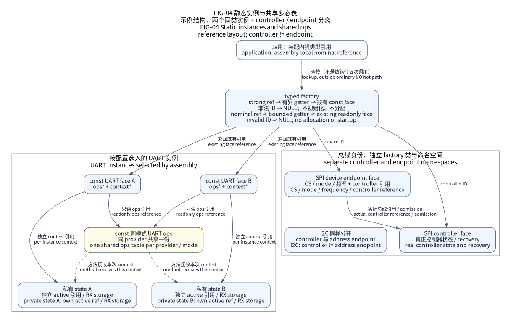

# I/O：类型化接口与共享执行机制

I/O 为应用和组件提供公共 C11 类型，为 SoC 的具体实现规定操作、借用与退出
合同。公共类型不含厂商 Handle 或寄存器布局。实际模式和受审路线以
[能力矩阵](../docs/delivery/capabilities.md)为准；公共头存在不代表每颗芯片实现
全部操作，也不授权未知 PCB 接线。

该图是精确参考装配，区分已有接口对象、共享方法表与独立上下文；查找不启动
硬件。当前通用装配与执行另见
[FIG-16](../docs/design/io-evolution.md)，范围与图例见
[图册](../docs/assets/diagrams/README.md)。

## 目录和构建边界

| 目录 | 责任 |
| --- | --- |
| `include/nexus/io/` | 公共类型、操作与所有权合同 |
| `src/api/` | 检查并分派到选定只读接口对象 |
| `src/mechanisms/` | 流、DMA 排空、唤醒、事务和观察 |
| `private/` | 无硬件依赖的验证、序列身份和日历 |
| `../drivers/` | SoC 私有选编的受审 IP 引擎／模板 |
| `../soc/native/drivers/` | 实现同一接口对象的独立宿主模型 |
| `../soc/<vendor>/<family>/drivers/` | 精确 MCU 具体实现和模式 |

物理 Platform 按 CMake 源码合同编译选定控制器域与组件依赖；空装配仍有时间戳
和诊断辅助。Native 与仅复用 CPU 的 Runtime
保留公共合同以接纳调用者自定义实现。所有配置组合可见公共头，未选操作
不成为第二个隐式具体实现；编译选择与最终 ELF GC 分别测量。

组件目标自己声明 I/O 域依赖。如 `Nexus::TMP117I2C` 链接
`Nexus::IOI2C`，外部资源责任者可提供端点，无需在装配中虚构物理控制器。
域静态库在选择或链接前排除构建，共享机制只编译一次；可选目标
仍可能出现在 `compile_commands.json`，实际选中的 Ninja 命令闭包和一次新构建
才能证明编译了什么。

## 静态实例与多态调用

每个选定实例具有只读接口对象，保存共享只读方法表和独立私有上下文。32 位
目标接口对象本身为 8 B，只读方法表、可变状态、选定缓冲区、已链接代码
另算。生成实例用精确静态存储，显式构造器用责任者提供的存储。

公共 API 验证接口对象后执行 `ops(context, ...)`，具体实现寄存器热路径可以私有
直接调用。缺失可选方法返回 `NX_ERROR_UNSUPPORTED`。不同具体实现／
模式表共存，不替换公共符号；IRQ 固定绑定实例，不逐字节查 factory。

factory 查询函数返回已有身份。查找、Platform 启动、请求准入、
推进服务、恢复、停止分开。SPI／I2C 控制器与端点身份独立，新产品
用强类型引用头文件；见[factory 合同](../docs/explanation/factory.md)。

RS485 适配器用同一强类型 UART 引用取得 `nx_factory_uart_ref` 和
`nx_factory_uart_tx_validator_ref`。仅受审精确模式导出回调，其他模式／
非法 ID 返回 NULL。查询不分配存储、不操作硬件、不准入传输；回调不是实例认证，调用者
配对精确上下文并独占 TX，提供稳定适配器／配置、GPIO 方向接口对象、
极性、方向建立／保持时长。不新增角色框架、每 UART 状态或方法表字段。

## 控制器、并行端点和内存窗口

外部总线路径分开共享 `nx_external_bus_port_t`、显示存储体
`nx_parallel16_endpoint_t`、SRAM 存储体 `nx_memory_window_port_t`。Platform
在 C 中准备控制器并获取显示存储体；factory 只返回稳定接口对象。并行字
调用同步完成，每次返回前结束所有 CPU 存储跨度的访问；显示组件消费公共端点／只读配置，
SoC 不导入组件协议或公开厂商类型。

内存窗口借用返回地址、字节数和代次，后续 CPU 直接读写该地址，
无逐访问分派。释放原稳定借用前须等待退出所有派生指针使用者。
`cpu-window` 与 `startup-memory` 是独立显式模式；后者整个镜像生命周期
持有 SRAM，不发放与已放置的全局对象重叠的整存储体借用。C 责任记录在
Platform 启动前已持有承载内存，上下文／预检／身份／启动失败都不能
抹除。全局停止在撤共享引脚／系统时钟前报告保留责任。几何
只描述选定事实，不证明实物焊接配置／时序；两类接口对象都不授予 DMA、
堆、外部栈或可执行内存权限。

## 借用、进度与排空

直接路径在允许上下文中由一个串行执行者推进。请求和有效数据
始终调用者持有，但借用持续到 acquire 观察 SETTLED。取消／截止时间／失败
排空不撤销借用；具体实现先撤硬件／IRQ／延后引用，最后以 release
发布。QUARANTINED 保留存储和清理责任。
[所有权表](../docs/explanation/ownership.md)区分直接、固定 IRQ、跨任务
适配器、等待与停机。

DMA 内存完成、线上完成、请求结清是独立事实。
具体实现检查精确可达性、选定域、Cache 所有权和真实
撤销。有限与连续传输各有明确的借用、重新武装接收和背压合同。默认没有
强制 OS 锁、隐藏驱动任务、通用缓冲区池；精确范围见
[DMA／stream 合同](../docs/design/io-evolution.md)。

流的 reserve／publish／acquire／release／abort／stop 操作只访问与块数无关的
固定数量的元数据。停止时检查未归还计数，不在屏蔽 IRQ 的区间扫描或撤销已借用块。冷态
重叠验证检查完整选定块组，是不同成本；复杂度不证明 IRQ 延迟。

`nx_dma_storage_validate` 分开验证整个预留区和有效数据。例如对齐 64 B
预留区可承载 17 B 有效数据并独占两条 32 B 缓存行，具体实现仍可施加
更严格模式约束。地址／容量须满足对齐、完整 DMA 可见域、
可选整行几何；不取整、不分配、不隐藏中转缓冲区。
调用者给出受审几何／独占所有权，具体实现另验证模式／能力并
执行必要 Cache 维护。取消／截止时间不允许在排空并以 acquire 观察 SETTLED 前复用。

## 观察、USB 激活与证据

`nexus/io/diagnostic.h` 组合复制的请求／流观察与明确已知的生命周期、
责任者准入、推进服务时间、观察者等待退出事实，独立保留发现项位／
未知分组。请求不变不证明未调用 service；服务间隔判定必须有同一单调域中的时间戳与预算。辅助函数和原因键不读取实时硬件状态，不改变
所有权、不推进或恢复设备。SETTLED 不证明传输成功或观察者已等待退出。
流的未归还计数包括生产者、待消费和消费者持有的借用，普通游标的
忙不描述私有预提交游标；未知保留，零发现项不证明健康。

可选 [USB activation](../docs/design/usb-device.md)保留独立不可变接口对象和
既有上下文。非零端点设置方法是有界控制器动作；外部
Chapter 9 策略拥有配置、回滚、普通数据包准入。不增加
默认工作线程或配置事务，公共声明保留上下文、部分效果
和完整停止责任。

Native、生产寄存器模型、选定 ARM 链接、物理 HIL 证明不同
性质。独立实例或目录组织不建立电气、实测时序或任意负载下无损；MCU 物理 HIL 保持 `not_executed`。
