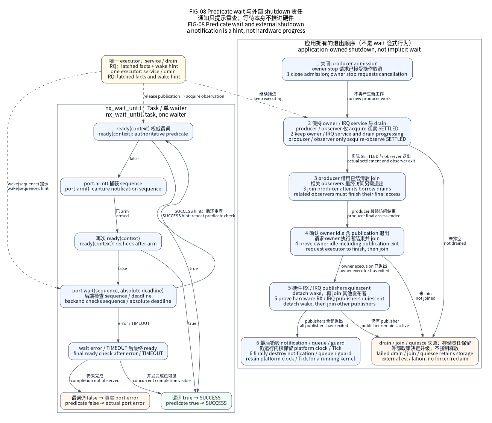

# OS：可选等待与内核适配

OS 层提供公共等待／唤醒合同和后端专用静态对象 API。裸机没有调度器，Native
使用 POSIX 线程，FreeRTOS 使用调用者明确选择的 TCB、栈和队列存储。
没有通用最大对象池、隐藏产品工作线程、默认定时器后台任务，也不让设备依赖 OS。

图表达当前“检查就绪 → 登记等待 → 再检查 → 等待 → 重查”及退出会合责任；图源、范围见
[图册](../docs/assets/diagrams/README.md)。它不建立物理时序资格。

## 分层与使用入口

公共抽象只有等待／唤醒端口。任务、队列、等待退出和存储 API 保持后端专用，
暴露真实内核控制块需求。产品换内核时显式调整任务生命周期，不存在统一 Task／
Queue ABI 或最大存储池。

| 入口 | 内容 |
| --- | --- |
| `include/nexus/os/wait.h`、`wait.c` | 公共判定条件等待和等待选择 |
| `baremetal/` | 非阻塞序列通知，无隐式调度器／WFI |
| `native/` | 宿主线程、通知、队列和等待退出 |
| `freertos/` | 静态 FreeRTOS 任务／队列／通知 |
| `freertos/mpu/`、`freertos/secure/` | 显式可选 MPU／分域安全配置组合 |
| `threadx/` | 真实 ThreadX Linux／M4 的明确适配范围 |

通知只是提示，调用者通过登记等待／复查观察权威请求判定条件。
内核 ISR 操作验证选定系统调用上限。Native 任务返回结束 pthread；
FreeRTOS 适配层发布完成后挂起，待外部删除；ThreadX 适配层
进入真实内核完成。唯一外部生命周期责任者成功等待退出后才回收适配层、
TCB、栈、上下文；完成提示不证明内核已拆除引用。应用拥有调度器
启动、工作线程、队列深度、公平性和停机执行进度。

## CPU、上下文与启动

FreeRTOS POSIX 验证夹具执行真实调度器和任务／队列生命周期。普通特权
运行时按受审 CPU 事实选精确锁定端口：M0／M0+ 用 CM0，M3／无 FP M4 用 CM3，
FP M4 用 CM4F，FP M7 用 CM7/r0p1，CM23／33／55／85 用各自 NTZ 端口和独立 ASM。
仅整数 M7 用受审构建期派生 CM3 端口，含保存 PRIMASK 的勘误 837070
保护区，厂商字节不改。宿主执行不证明 MCU 异常优先级、FP／MVE 上下文、
栈高水位或时序。

运行 API 要求特权线程模式，且 PRIMASK、BASEPRI、FAULTMASK 均清零。
调度器启动前有独立例外：Baseline 端口可保留 PRIMASK=1，Mainline 可保留
精确的系统调用 BASEPRI；仅接受该端口的规范引导屏蔽状态。数值匹配不能证明
调用者拥有屏蔽状态的控制权。故障屏蔽或其他屏蔽状态在对象变更前拒绝；
只读调度器查询区分内核引导、运行中任务和调度器暂停期间的任务。
Baseline IRQ 唤醒遵守 PRIMASK 内核合同，Mainline 还验证实际边界、
优先级位宽和系统调用上限。

首次调度器启动要求冷态特权线程模式／MSP，CONTROL.FPCA 清零；应用
不能在内核引导前遗留活动 FP 上下文。MPU 启动保护区依据真实来源／栈帧
消费受保护单次使用租约。v8-M `security = "single"` 是 Arch 状态 0，
不是 Nonsecure；它使用传统 FD／F9 返回组合，但没有 CMSE 权限。显式 Secure
使用相同组合和独立 Secure 事实，Nonsecure 用 BC／B8。
`NEXUS_CPU_SECURE_ONLY` 仅选择端口编码，不授予单世界 Secure 权限。

## MPU、TrustZone 与 FP／MVE

Armv8-M 明确选择 NTZ、仅安全态或 Nonsecure 独立。NTZ 内核不分配
Secure 任务上下文、不开放跨世界 Secure 调用。Secure 启动负责 SAU／IDAU
和 Nonsecure 协处理器访问。NS 本地中断屏蔽不能阻止 Secure 发布者并发
访问受保护状态。

默认任务 API 仍只允许特权调用。显式 MPU 配置组合有独立静态受限任务
生命周期，默认只开放无指针的延时／节拍 SVC。调用者提供受保护
元数据和受审用户链接器区域，不开放通用用户对象池或特权
I/O。M0／M0+、M7 MPU 与 MPU＋分域安全组合拒绝；详见
[MPU 入口](freertos/mpu/README.md)和[OS 合同](../docs/design/os-contracts.md)。

分域模式选择真实具备 TrustZone 上下文支持的 NS 端口，另链接 Secure 裸机 Runtime
与 `Nexus::SecureContext`。两幅镜像匹配 CPU／ABI，并使用真实 CMSE 导入／SG。
包括 Idle 的每个授权任务都有调用者持有 NS TCB／栈和不可变受信
映射选择的已准备 Secure 元数据／栈。无 Secure 堆／最大上下文池。
NS 特权内核受信，SAU／IDAU、启动、向量、NSC 归属、IRQ
路由属消费方／SoC。见 [Secure companion](freertos/secure/README.md)。
两幅镜像链接／宿主租约测试不证明物理归属、上下文保留、
栈峰值或对抗恶意 NS 内核的隔离。

M55／M85 使用真实具备 MVE 上下文支持的上下文端口。`configENABLE_FPU` 为 FP 或 MVE
开启共享协处理器寄存器组与扩展／惰性栈帧，标量 FP 事实独立。
仅整数 MVE 用 `+nofp` 和 softfp ABI，高位共享寄存器组由端口保存；
完整低位寄存器组和 VPR 依赖硬件扩展异常栈帧，仍属物理切换验收。
编译合同不保证跨世界有效数据保留。

## 宿主实现与持续等待

FreeRTOS 宿主验证夹具保留锁定内核／POSIX 端口，使用自有
`tests/contracts/os_freertos_runtime/posix_event.c`。端口先取消正在等待条件变量的 pthread，再发送信号并等待退出；上游事件支持缺少取消清理，可能留下锁住的
互斥量。自有等待在返回和取消时都解锁，避免重复任务等待退出死锁；
此修正只作用于宿主，不改变 MCU 后端，也不建立 MCU 调度器资格。

有限通知截止时间在合并序列提示后也检查；无关连续
唤醒不能延长预算。超时后最终再观察判定条件，真实完成可以赢得
竞争。队列保留立即尝试语义，仅阻塞时消费绝对预算；
`NX_DEADLINE_NEVER` 使用真实无时限宿主等待。

任务创建在内核变更前验证端口启动栈帧／对齐，最小
栈帧不等于运行栈预算。每个可返回任务由唯一外部责任者等待退出；Native 任务
不得绕过适配器取消任务或执行 pthread detach。永久任务、直接通知是显式
可选瘦路径，有独立存储和接收者／索引合同。

## 关闭、低功耗与验证

可关闭队列用独立调用者持有控制对象和每操作等待者，原始队列保持最小
原生阻塞实现。关闭时依次关闭准入，保持责任者推进服务，结清并等待生产者退出，再等待责任者
退出，撤销并排空硬件 IRQ 发布源，最后销毁
通知／队列／保护区。外部 UART 责任者示例演示此流程。

无节拍空闲仅在显式定时器端口和连续时钟完整绑定时启用，否则普通 Tick
继续。诊断用调用者指定容量的环形存储和默认无操作的弱钩子。追踪、低功耗、任务
隔离不自动建立物理资格。`tools/hil/os_acceptance.py` 准备或
验证保留的 OS 硬件记录，不操作设备，未执行项仍是 `not_executed`。

维护状态见[OS 交付](../docs/delivery/os.md)、
[OS01–OS55 台账](../docs/design/os-execution.csv)。新内核遵循
[后端接入合同](../docs/design/os-backend-integration.md)并执行实际探针；探针
通过本身不登记新的受支持 RTOS。
