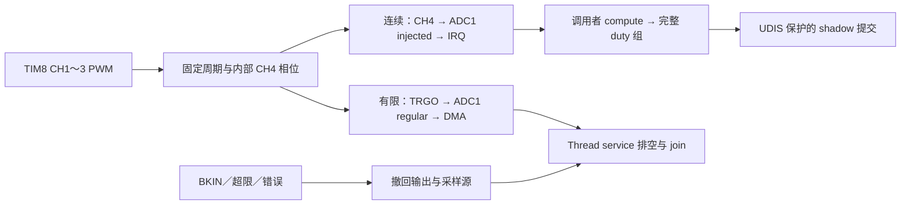

# PWM 与 ADC 的单一硬件 owner

本目录提供 STM32F407ZGT6 的两个显式软件参考模式。一个装配只选择其中一个，
同时独占 TIM8、ADC1／2／3 共享域和所需 IRQ；有限模式另占 DMA2 Stream4。
公共 factory 返回已经存在的只读 face，不启动采样、输出或任务。



箭头表示选定生产 C 的硬件事件和执行关系。它不表示已执行实板控制、FOC、采样精度
或电气保护资格。当前软件路线使用 PC6／PC7／PC8 的 TIM8 CH1～3、PA6 BKIN 和
PA0 ADC1_IN0；公开 Board 没有因此获得功率板接线授权。

## 两种模式

| 选择 | 公共接口 | 行为与存储 |
| --- | --- | --- |
| `finite-regular-dma` | `pwm_adc.h` | 一个完整固定 duty 窗口；DMA 借用调用者 raw sample 数组，结束后停止输出；不自动重启 |
| `injected-control` | `pwm_adc_loop.h` | 一个有有限 deadline 的连续 session；ADC IRQ 取得完整 scan，执行调用者 compute，再提交完整 duty 组 |

有限模式采用 RM0090 Rev22 Table68 的 TIM8 TRGO 与 Table44 的 DMA2 Stream4
Channel0。连续模式采用 Table69 的 TIM8 CH4 injected trigger，不使用 DMA。
当前声明路线只选择 ADC1_IN0、12 位无符号原始码和三个非互补 PWM 输出，deadtime
为零；其他通道、互补功率级、传感拓扑和电机算法保持各自明确的后续接入范围。

两模式分别持有可变状态，共用 `analog.c` 的 ADC cold／部分失败撤回和已有 timer
waveform 引擎。连续实例不保留有限 request、DMA loan 或 DMA buffer。复用的
waveform 子状态仍有既有 pulse／sequence 字段成本；实际 ARM 布局应按当前构建
测量，不能将链接夹具全部 `.bss` 当成每实例成本。

## 有限窗口

1. Platform 在 GPIO／共享 DMA 时钟就绪后取得 ADC 与 timer，保持输出和采样关闭。
2. 提交前验证完整 request、duty、sample 数量、DMA 内存域、deadline 与别名。
3. ACCEPTED 后借用 request、duty 和 samples；ADC warmup 后由显式 service 启动。
4. IRQ 只锁存真实 TC／error／break 并抑制源；Thread service 完成输出、ADC、DMA
   地址与 IRQ 退出后发布 `SETTLED`。

DMA TC 不证明精确输出脉冲数。没有可信完成时间时，首次在 deadline 之后观察到
完成仍报告 TIMEOUT。取消或停止失败不允许复用 sample、duty 或 request；恢复
service 必须使用原 owner，无法证明退出时保持 `QUARANTINED`。

## 连续快环与时间前提

连续模式固定 timer tick 为 1 MHz，`period_ticks` 因而也是名义微秒数。配置显式给出
`trigger_ticks`、`commit_before_ticks`、`compute_budget_ticks` 和
`max_irq_delay_us`。后两者是调用方必须满足的上界，软件声明不建立物理 WCET。

配置期与 C 准入共同检查：

```text
conversion_us = ceil(sum(sample_cycles + 12) * 1000000 / adc_clock_hz)

trigger_ticks + conversion_us + max_irq_delay_us
    + compute_budget_ticks + 4 < commit_before_ticks

commit_before_ticks <= period_ticks - 2
```

`compute_budget_ticks` 覆盖完整 scan 取得、compute、整组 shadow 写入与检查。
4 微秒预留 Core 微秒量化、初始锚点和提交检查裕量；它不能代替实际 IRQ、总线和
回调预算验证。频率与可用计算时间由所选 period／采样时间共同限制。

启动后，C owner 在两次 Core 时间读取之间关联 TIM8 CNT；读取间隔超过 1 微秒、
已经发生 update 或首个 trigger 已经过时即拒绝继续运行。由该区间建立持久 Core
时间锚点，每个有效周期严格前移一个 period。JEOC 先通过绝对锚点与 modulo CNT
检查，compute 后再次检查 Core 时间、phase 和完整 shadow 更新。因此，延迟整
个 period 后 CNT 恰好落回窗口也不能被当成新鲜周期。

JEOC 是合并状态，不是硬件转换计数。此模式还要求实际 IRQ 延迟符合声明，Core
时间源与所选 System epoch 持续有效。读取期间或 compute 后再次出现 JEOC、
迟到、callback 超限、break、部分 shadow 写失败均锁存错误并抑制输出，不发布
混合 duty 组。`completed_cycles` 是 64 位已接纳计算／提交计数，不是物理脉冲计数。

## 上下文与借用

prepare／start／service／stop／state／close 由一个 privileged、未屏蔽的 Thread
串行调用。compute 仅运行在选定 ADC IRQ，必须有界；它不能调用 Thread-only
encoder／waveform／文件／网络／OS 方法，不能保存本次 scan／output 的临时指针。

session、sample、duty、callback 及其 context 借用持续到 acquire 观察 `SETTLED`。
context 可以引用独立有界 queue／原子 mailbox，按这些对象自己的合同交接目标；
任务不能并发逐字段修改被借用的 PID、算法历史或 session。opaque context 的
完整跨度由调用方证明，公共 API 和 provider 只拒绝已知起始地址别名。

先停止新目标与使用者，再 stop／service 退出 callback 和 IRQ，最后 Platform
close 归还 cold 资源。输出已关闭与借用已退出分别判断；失败 IRQ join 保留整个
session。显式 stop 后通过 cold close 和重新初始化建立新会话，不自动恢复输出。

## 验证与消费者

- `tests/google/soc/f407_pwm_adc_test.cpp` 编译生产 C，以外部 MMIO／IRQ／时间叶模型
  验证两模式、拒绝、取消、迟到 IRQ、覆盖、借用别名和部分失败。
- `tests/contracts/f407_pwm_adc/` 与 `tests/contracts/f407_pwm_adc_loop/` 验证真实
  TOML、生成 factory 和 ARM 链接／预算；冷态链接消费者不执行实板快环。
- 公共消费者继续通过 `nexus_factory_strong.h` 取得选定 face；有限与连续强类型
  namespace 分开。产品拥有任务、功率板、控制政策和实板测量。

物理测试状态保持 `not_executed`。
