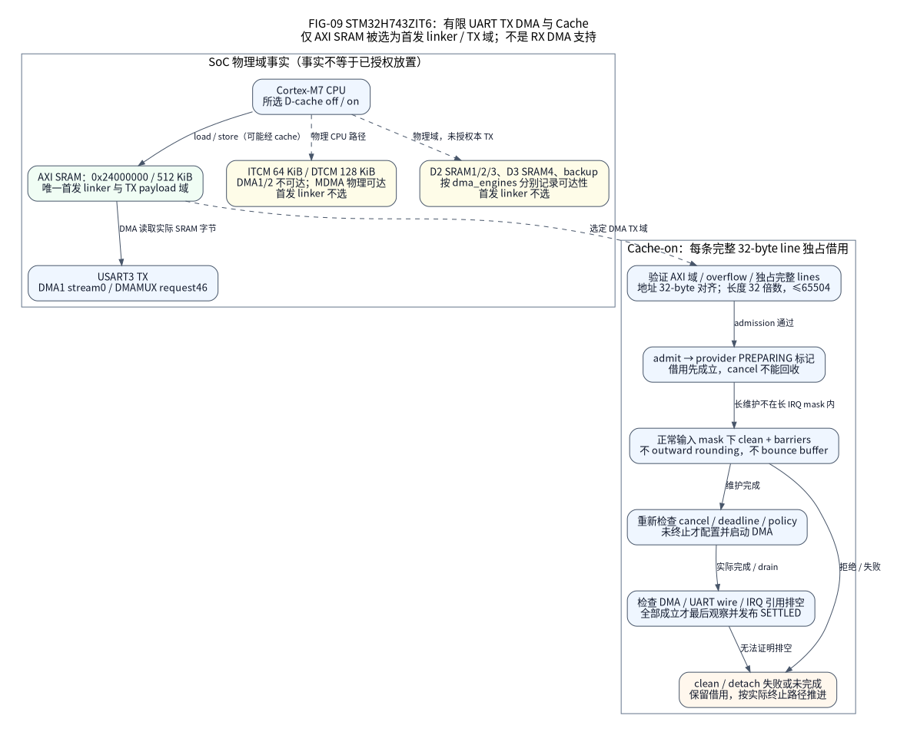

# STM32H743 芯片集成与软件参考

本目录维护精确 **STM32H743ZIT6** 的软件参考。默认 NUCLEO-H743ZI2 配置使用官方
Cortex-M7 启动代码、有界 LDO 电源入口、固定 HSI32／HSI64 时钟、显式关闭／开启
Cache、TIM2 1 MHz 时间基准、GPIOB PB0，以及 USART3 PD8／PD9 AF7。USART 可选
IRQ 字节模式、有限 TX DMA＋IRQ RX，或有限 RX DMA＋IRQ TX。独立的
`stm32h743zi_hsi_reference` 仅声明下文复用外设的软件接线，不证明真实 PCB 或器件。
全部物理 HIL 为 `not_executed`。

## 架构与维护入口

| 入口 | 职责 |
| --- | --- |
| [system.c](system.c) | 电源入口后的 CPU 设置、固定时钟／TIM2／Cache 生命周期和终止故障 |
| [platform_cold.c](platform_cold.c) | 选定资源准入、共享 GPIO／时钟撤回、部分失败恢复 |
| [drivers/](drivers/) | 具体模式的 C 准备／服务／关闭流程、借用与硬件排空 |
| [configure/](configure/) | 静态策略、精确实例存储、类型化直接调用与固定连接 |
| [CMakeLists.txt](CMakeLists.txt) | 唯一实际源码图，私有选择 SDK 和模式实现 |

冷态硬件算法及固定运行配置的暂停／恢复资源路径均由 C 实现。空收条不能停止尚未
取得的活跃资源，恢复失败保留原值与清理责任，等待重试。公共 GPIO／UART C11 接口
只读，实例私有状态和显式字节环形缓冲区相互独立；共享的只读操作表直接执行热路径
I/O。没有分配器、后台工作线程、运行时注册或 DMA 回退。factory 查询只返回已有
静态接口，不启动硬件。

仅表示图中明确的有限 USART3 TX 参考，不把它推广为所有 RAM／DMA 模式资格。
[共享 IP 图 FIG-31](../../../docs/assets/diagrams/driver-source-ownership.svg)表示
编译期源码归属，不新增运行时转发层。

## 精确模式导航

| 选择 | 精确边界 |
| --- | --- |
| 固定 HSI | `hsi32-fixed-cache-off`、`hsi32-fixed-cache-on`、`hsi64-fixed-cache-off`、`hsi64-fixed-cache-on` |
| 高频参考 | `hsi64-pll384-cache-off`，仅 DEV_ID `0x450`／REV_ID `0x2003`（V），冷态启动 |
| USART3 `dma-tx` | DMA1 Stream0／DMAMUX1 Channel0，请求编号 46；RX 为 IRQ 字节模式 |
| USART3 `rx-dma-idle` | DMA1 Stream1／Channel1，请求编号 45；TX 为 IRQ，有限普通 RX 有重新装载间隙 |
| USART3 `rx-dma-continuous` | V／HSI64／默认微调值／裸机／AXI，两个硬件 RX 目标块＋替换块，TX 为有限 IRQ |
| USART3 `dma-duplex-continuous` | 上述连续 RX＋独立有限 TX DMA，不扩展至 PLL384／RTOS／D2 RAM |
| USART3 `irq-fifo-bytes` | HSI64／Cache 关闭、8N1、有界 16 字节 RX／TX FIFO |
| SPI4 有限 DMA | V／HSI64／默认微调值／裸机／AXI、mode0、8 位，显式选择关闭／开启 Cache |
| 其他有限外设 | 下文列明的 SPI4 轮询、I2C1、ADC1、TIM3 CH1、EXTI、IWDG1 和 Flash |

未列模式在配置时拒绝。应用、Flash 区域、安全输出和外部器件策略属于外部工程。

## 复位、电源与所有权

官方复位流程在 `SystemInit`、DATA／BSS 和构造器之前先调用 `ExitRun0Mode`。
RM0433 Rev9 6.4.1 禁止在 Run-star 状态的 ACTVOSRDY 就绪前写入任何 RAM。入口仅用
临时寄存器与 PWR MMIO，不压栈、不向栈溢出保存、不调用其他函数或访问主 RAM。
它读回 LDO／BYPASS，并最多检查 1000000 次就绪状态；拒绝时屏蔽 IRQ，在 r0 保留
原因 1（就绪超时）或 2（供电配置读回失败），随后进入不可返回的停驻循环。
轮询次数不证明实测时间，生产 C 对照固定 SDK 静态断言汇编地址／位。

进入任何 C 栈访问前读取 `DBGMCU.IDCODE.REV_ID`。小于 `0x2000` 时，按 ES0392
2.2.10 设置 `GPV.AXI_TARG7_FN_MOD.READ_ISS_OVERRIDE=1`，保留其他位、执行 DSB 并
读回；失败保留原因 3，进入不可返回的停驻循环。新修订跳过写入。判断遵循锁定的
ST 模板 `8f922cdc7cc6de2344e75ddd657889f4ff761790`，不猜测修订。ARM 检查覆盖
整个 140 字节叶函数、两个条件路径、MMIO、屏障和故障退出；旧修订 SRAM 可靠性
仍须实板验证。

电源入口允许栈访问后，`SystemInit` 只访问 CPU／系统寄存器，明确 FPU／向量／
中断分组 ABI，不使用已初始化全局变量。固定 HSI 以冷态 HSI64、未分频总线、就绪
LDO、保守的复位 Flash 7WS、Cache 关闭为前提，未知运行状态在修改前拒绝。Cache
已知干净必须来自可信复位，或先前成功执行的自有清理／关闭；CCR 清零不能证明
不存在外来脏缓存行。不自动接管运行中时钟、bootloader、Cache、调度器或其他供电
状态。运行时持有保留 TIM2／IRQ 的责任，失败保留清理责任；HSI／LDO／Flash 是启动
前提，运行时停止不撤回它们。

TIM2 冷态准入检查 CR1、CR2、SMCR、DIER、CCER 及两个 CCMR：CEN 不活跃不等于
没有触发／引脚／捕获使用者。关闭的时钟门控可能隐藏保留寄存器，因此先仅取得可逆
门控，再在复位／UG／分频／Cache 修改前复查。第二次准入失败只恢复新增门控，不清
外来定时器、复位、标志或向量；门控回滚失败单独保留责任，不冒充定时器所有者。

固定 HSI32 仅在准入后修改 HSIDIV，确认 HSIRDY／HSIDIV／HSIDIVF 后才发布频率并
开启 TIM2。UART 使用同一选定 APB，TIM2 为 PSC31／PSC63。停止先撤回定时器，再
恢复所持分频设置；分频／时钟源写入遭拒时保留重试。这是固定冷态配置，不是运行时
变频。

Cache 开启配置通过调用者持有的 Arch 控制对象管理两个受审 M7 Cache。外设实现
排空后才可撤回 Cache；外设停止失败阻止 Cache／时间基准关闭，Cache／选择器恢复
失败则保留控制对象，并阻止分频恢复。同一解析配置在关闭 Cache 时，于编译期去掉
控制字段和冷态 Cache 调用。既有 ARM 系统对象在关闭时为 48 字节、开启时为
56 字节，12 字节控制对象复用原填充空间；这是静态对象大小，不是实测延迟或一致性。

## TIM2 时间域与终止故障

更新预分频器时，先观察旧 UIF 经 W0C 清除，UG 后新 UIF 再经观察确认清除，才发布
时间域。复位值 MMS 会把 UG 导出为 TRGO，因此责任者先观察 `MMS=1,CEN=0`，
处理 UG／UIF 后恢复并观察 `MMS=0` 才设置 CEN。恢复遭拒时保留静默 MMS 和定时器
责任，停止不会提前释放门控。

溢出 IRQ 只统计已确认的标志。确认清除失败使时间代次无效，记录 `timer_error`，
保留 TIM2 并尝试有限次 DIER／CEN／NVIC 撤回。截止时间域丢失始终触发终止故障，
即使源隔离成功，也屏蔽 IRQ、调用有界故障观察回调；回调返回则进入不可返回的停驻
循环。无效的零时间不能让使用者继续运行或释放 I/O 借用；普通停止／重启不恢复此
终止路径，产品需另外审核不可返回的恢复方案。快照在同一次保存的中断屏蔽状态内
检查时间代次和两个 32 位计数器字；零不表示就绪，失效后的旧截止时间不可复用。
这里不提供通用健康管理器或产品策略。

## GPIO 与普通 UART 生命周期

生成装配开启全部选定 GPIO 端口，在捕获任何字段前验证全部引脚均未锁定、处于
输入／模拟模式；门控关闭时隐藏的外来引脚占用会被拒绝，不写引脚或越权取得租约。
只保存选中字段／锁存值和新增门控，部分初始化时把失败实例也纳入逆序清理。GPIO
先预装载／读回安全锁存值，再发布输出模式；外部使用者必须先完成会合，才能停止。

USART3 IRQ 字节模式使用锁定官方 LL 的 RDR／TDR，公共载荷以字节为单位，硬件仍
按 32 位字访问。原状态、RX 错误／丢失、TC 与借用／排空顺序保留；共享此 IRQ 配套
实现的 DMA 模式沿用相同合同。普通配置为 8N1、PRESC1、选定 PCLK、关闭 FIFO，并
观察 TEACK／REACK／IRQ。每次 IRQ 至多搬运 1 个 TX 和 1 个 RX 字节。请求只在真实
线上 TC、源及引用全部撤回后进入 SETTLED；失败保留 QUARANTINED。停止会合通知
发布者，证明 UE／ACK／IRQ 撤回后才释放环形缓冲区／唤醒对象。

## USART3 有限 DMA

### 有限 TX 与 IRQ RX

`dma-tx` 的 DMA1 Stream0／DMAMUX1 Channel0／请求编号 46 使用独立于 USART3 的
向量，RX 保持显式有界 IRQ 字节环形缓冲区。不开放 RX DMA、循环模式、流池或回退。
冷态准入拒绝已占用的通道、复用器或向量；装配只记录新增门控，清理失败时保留。

TX 仅接受选定且初始化的 AXI SRAM 和显式预算的 D2 SRAM1，借用前拒绝 TCM、Flash、
未供电／未选定的 D2／D3 和算术溢出。Cache 关闭时为 1..65535 字节，开启时地址
对齐、长度占用完整独占 32 字节行，最大 65504；不向外取整或使用隐藏中转缓冲区。

准入在清理 Cache 前建立请求／存储借用；PREPARING 允许恢复调用者正常中断屏蔽
状态后执行清理，取消不能提前结束借用。启动 DMA 前复查取消／截止时间。平台运行
周期内 Cache 策略固定。DMA 完成不等于 UART 线上 TC；DMAT、EN、传输源和全部
引用撤回后才进入 SETTLED，遭拒时隔离等待重试，迟到 DMA 错误优先于成功。失败
报告 0 字节，不从 NDTR 推测线上发送量。

### 有限 RX 与 IRQ TX

`rx-dma-idle` 使用 DMA1 Stream1／DMAMUX1 Channel1 请求编号 45 和精确向量，TX
复用普通 IRQ 实现。不生成字节环形缓冲区；调用者初始化 `nx_stream_t` 与精确块
数组，经 `rx_start` 提交。首次借用前验证每块：位于选定且初始化的 AXI／SRAM1
DMA 可写域，并与实现私有状态、MMIO、区域描述符、流／槽元数据、唤醒对象和活跃
TX 分离。Cache 关闭时为 1..65535 字节，开启时为对齐独占 32 字节行、至多 65504。

普通 DMA 写入一个生产者借用块，满块或 IDLE 开始有界撤源。RM0433 15.3.16 允许
软件中止后 TCIF=1 而 NDTR 非零；只有实读 EN／DMAR 均关闭后，稳定的剩余计数才
用于有效 IDLE 前缀。DMA 持有 RX 时 USART IRQ 不读 RDR。DMA／UART 错误经证明
排空后丢弃该借用块，报告一个丢失边界，不发布不确定字节；确认清除只作用于选定流。

Cache 开启时，在 DMA 前和排空后各失效完整自有缓存行，再发布生产者块。两次都在
责任任务、屏蔽区外执行，PREPARING／PROCESSING 保留借用。EN／DMAR／源／Cache
撤回失败则保留并隔离，TC 或取消不能撤销借用。生产者、READY 或消费者借用尚在时，
停止保留流、时钟、Cache、时间责任。全部归还后，成功的 RX 停止允许显式初始化新流，
无需重启控制器。

责任者的服务调用负责发布，并装载下一个 FREE 块，因此存在重新启动间隙；不覆盖
已借块，不声称循环／连续无缝或逐字节精确丢失。本有限模式不继承下节双缓冲区，
也不扩展其他 H7 DMA 引擎或物理 Cache 一致性资格。

## 连续 RX DMA

`h743-uart-continuous.toml` 与 `h743-uart-continuous-cache-on.toml` 选择
`rx-dma-continuous`：STM32H743ZIT6 V、固定 HSI64／默认用户微调值（HSITRIM=`0x40`）、
裸机、USART3 PD8／PD9、DMA1 Stream1／请求编号 45、优先级 5 且不调用 OS 的 IRQ。
TX 仍为独立有限 IRQ，不提供连续 TX DMA 或通用双向 DMA。

调用者提供至少 3 个已初始化 AXI SRAM 中等长、不重叠的块。Cache 关闭时每块
32..65535 字节，开启时为对齐完整独占 32 字节行、32..65504 字节。两个已提交的
生产者借用块装入 M0AR／M1AR 后保持 FILLING；服务调用用第 3 个 FREE 借用块替换
非活动地址，不关闭 DBM／CIRC。证明旧地址已脱离硬件后，才执行 DMA 后的 Cache
失效并按 FIFO 顺序发布。IRQ 只锁存完成、屏蔽 TC 后等待服务，不执行长 Cache 操作
或发布载荷。[已提交借用块图 FIG-15](../../../docs/assets/diagrams/continuous-stream.svg)
使用明确标注的 F407 参考说明共享原则；H743 额外拥有本节 Cache 与同源截止时间检查。

保持置位的 TC／1 位 CT 无法统计漏圈，因此替换前后都检查绝对替换截止时间。
USART PRESC1／OVER16／8N1 与 TIM2 PSC63 同源，实际 BRR 决定比例，不用名义波特率
或主机时钟。按每字节至少 8 个 BRR 时钟周期保守替代理想 10 位帧，再扣 20 字节与
2 个定时器节拍；20 字节上界覆盖 16 字节 FIFO、RDR、移位寄存器、直接传输节拍边界，
向上取整，NDTR 已计 FIFO 时仍重复扣除。还检查 TIM2 内部向上计数模式、ARR、DIER、
溢出向量、时钟／复位和 UART／Cache。这是无法证明即停止的软件准入界限，不是
实测服务延迟。

没有 FREE 替换块时停止生产并记录一个丢失边界，不覆盖 READY／持有缓冲区；迟到
或不确定的缓冲区切换历史会使未证明的生产者字节被丢弃。IDLE 关闭本次生产者，只
发布已排空前缀。成功 RX 停止、消费者会合、流重新初始化后显式重启，不自动重新
装载。RM0433 Rev9 15.3.19 的实际 EN=0 读回证明内存排空，关闭写入或旧 TC 不算。
Cache 操作在屏蔽区外，准备／处理防护在递归控制、失败维护期间保留全部借用。
时钟／定时器／复位／Cache 违例会永久污染本次保留生命周期，即使寄存器恢复也不能
解锁。开发模型、普通 ARM、SDK 分别为证；吞吐、一致性、延迟与 HIL 均未实测。

## 连续 RX＋有限 TX DMA 双向模式

[`h743-uart-duplex-continuous.toml`](../../../tools/configure/assemblies/h743-uart-duplex-continuous.toml)
及其 [`cache-on` 版本](../../../tools/configure/assemblies/h743-uart-duplex-continuous-cache-on.toml)
选择 `dma-duplex-continuous`，仍为上述 V／HSI64／默认微调值／裸机、PD8／PD9 AF7、
优先级 5、`calls_os = false`。原 `rx-dma-continuous` 仍保留 IRQ TX。

| 通道 | 引擎 | DMAMUX1 | 请求编号 | 向量 |
| --- | --- | --- | --- | --- |
| 有限 TX | DMA1 Stream0 | Channel0 | 46 | DMA1 Stream0 IRQ |
| 连续 RX | DMA1 Stream1 | Channel1 | 45 | DMA1 Stream1 IRQ |
| 线上／IDLE／错误 | USART3 | — | — | USART3 IRQ |

一个不可变 UART 接口连接一个私有上下文、既有 RX 责任对象与附加 TX DMA 扩展，
仅 RX 模式的存储不变。两种模式共用 RX 借用算法，`dma-tx` 和本模式共用有限 TX；
临时私有调用视图不增加注册表、持久分派对象、缓冲区池或工作线程。

双向均限选定且初始化的 AXI SRAM `0x24000000..0x24080000`。TX 在 Cache 关闭时为
1..65535 字节，开启时为对齐完整独占 32 字节行、32..65504。TX 与完整 RX 池、流、
槽、请求、责任对象、唤醒对象均分离；Flash 常量不能作为 DMA 载荷。RX 保留双目标块／
备用块、持有块保护、替换时限与丢失后停止；存储和消费者全由产品提供，不隐式复制、
拆分传输或回退内存域。

TX Cache 清理和 RX 维护均在 ISR／屏蔽区外执行，期间取消仍保留请求。TX 要同时
满足源／引擎／IRQ 撤回和最终线上 TC；RX 停止不结束独立 TX 责任。Platform 停止
会合 RX 借用与 TX 内存／线上活动后，仅恢复自有通道、FIFO 与 UART 分频到冷态，
再释放门控／Cache，成功后可再次正常启动。恢复遭拒时保留责任对象，返回失败供重试，
不复位共享 DMA 域。

观察到时钟／定时器／复位／Cache 丢失后永久污染，隔离全部 3 个向量，停止后续
I/O MMIO、生产者发布和借用归还。恢复寄存器不授权解除隔离，请求／生产者仍为
QUARANTINED。Native／模型、正常 ARM 资源、SDK 和站点各自为证；本模式不扩展
PLL384、RTOS 或 D2 RAM，物理双向吞吐／Cache 一致性／时序未执行。

## 有界硬件 FIFO 字节模式

独立 `irq-fifo-bytes` 为 USART3 PD8／PD9 AF7、8N1、优先级 5、精确
`hsi64-fixed-cache-off` 64 MHz。每方向 FIFO 16 字节，RX 另有 1 个 RDR。阈值和每次
RX／TX 字节预算独立；IDLE／阈值处理程序各方向不超过预算，经确认的 RX 非空后备
路径排空短尾，保留每个队首的错误次序。TX 空位／FIFO 空不表示线上 TC。取消、排空、
整机停止在源、向量、通知发布者和 UE／ACK 撤回前保留存储。

选配状态只增加常量配置引用，普通 UART 状态／操作表和关闭 FIFO 的 DMA 不变。
不允许高频、DMA、非 8N1 或流控组合。与 U575 共用编译期算法和锁定 LL USART
叶操作，没有第二个硬件责任者。原开发记录含 45 项真实实现、9 项正常 TOML／factory
模型，以及正常 ARM、资源／保留检查，见
[FIFO 合同](../../../docs/design/uart-fifo.md)。有界寄存器访问不是实测延迟或吞吐，
HIL 为 `not_executed`。

## 可选 V 修订高频参考

`hsi64-pll384-cache-off` 只接受 DEV_ID `0x450`、REV_ID `0x2003`（V）。`0x1003`
无法区分 Y／W，`0x2001`（X）及未知修订拒绝，不回退。这是冷启动，不是运行时
变频或任意 H743 修订支持，选前应读
[高频合同](../../../docs/design/h743-high-clock.md)。

名义 CPU／HCLK／APB 为 384／192／96 MHz，TIM2／TIM3 为 192 MHz，不是 CPU 频率。
USART3／I2C1 使用未倍频 HSI64；SPI4 按 APB2 的 99.45 MHz 审核上界选择分频。
ADC12 从 per_ck 接收 HSI64，只有实际初始化 ADC1 后才设置异步 /4、名义 16 MHz；
空装配不配置转换。

62..65 MHz HSI 包络来自 DS12110 Rev11 V 修订在出厂、电压、全结温范围的条件，
不是实测，PLL 预算还加入 RM0433 Rev9 的 PLL 就绪偏差。因此，请求 115200、BRR556
时可约为 111511..116906 baud；本地分频合同不验证对端、线路或容差，完整计算和
条件见高频合同。

4 字节时钟责任记录统一持有电源／Flash 保护、PLL、总线、内核时钟选择器。升频前
证明 VOS1 和 Flash 2WS／WRHIGHFREQ2；停止先会合设备／TIM2 System，再证明实际
回到 HSI 后才降低保护，拒绝撤回则保留已有硬件效果。高频使用这个联合责任对象，
不使用固定 HSI 的可选 Flash 时序责任对象；Flash 原几何、电压、对齐、新擦除和
编程脉冲排空规则仍有效。

既有 4 个固定 HSI 配置不选入高频责任对象／编译单元。4 字节是责任类型大小，不是
完整镜像 RAM 差值；默认机器码／链接成本需另查。未开放 Cache 开启、bootloader
接管、运行中时钟变更。原开发记录的 38 项时钟、19 项高频 System、30 项内核、
10 项正常生成 factory Google 用例及 3 个 ARM 预设已通过：
`fixture-io-evolution-h743-high-empty`、`fixture-io-evolution-h743-high-uart`、
`fixture-io-evolution-h743-high-peripherals`。这些是开发软件证据，HIL 未执行。

## 内存与 DMA 可达性

默认链接布局为 AXI SRAM 512 KiB。D2 SRAM1 必须显式以 `[memory.regions.sram1]`
字节预算选择。MMIO 电源入口允许 RAM 访问后，复位流程开启／观察 SRAM1 时钟，
按检查后的链接边界复制选定 DATA、清除 BSS，早于主 DATA／BSS／构造器；NOINIT
由调用者初始化。启动流程持有的 SRAM1 门控不随 Platform 停止撤回，外部电源策略
修改前须会合全部使用者；DMA 准入在借用前复查门控。

`NX_MEMORY_SRAM1_DATA`、`NX_MEMORY_SRAM1_BSS`、`NX_MEMORY_SRAM1_NOINIT` 只放置
变量，不授权执行。DMA1 只接纳选定且初始化的 AXI／SRAM1，Cache 开启时仍需整行
独占；其他域未选择。ITCM／DTCM、D2／D3、后备 SRAM 事实分别保留 DMA1／DMA2／
BDMA／MDMA 可达性，MDMA 能到 TCM，不能用一个 DMA 布尔值抹平。可达性不等于
合法放置、缓存所有权、供电保持或执行权限。其他域／DMA 路线、动态 PLL、深度 STOP、
bootloader 交接各有独立实现和验收退出条件。

## 选定有限外设

软件参考 [`peripherals.toml`](../../../tests/contracts/h743_assembly/peripherals.toml)
在 32／64 MHz HSI、Cache 关闭、裸机／FreeRTOS 下链接 7 类外设；UART／GPIO 仍
独立选择。公共接口不暴露 MMIO 或私有构造器。

| 控制器 | 精确模式与限制 |
| --- | --- |
| SPI4 | PE12／13／14 AF5，PE11 低有效 CS；8 位全双工轮询 1..256 字节，有限截止时间，请求 SCK<=16 MHz；观察默认 APB2 内核时钟选择器 |
| I2C1 | PB8／PB9 AF4 开漏、7 位端点、标准模式上限 100 kHz；重复 START／有界分块／最终 STOPF／BUSY 排空或显式复位，外部上拉 |
| ADC1 | PA3 INP15，16 位单次、采样编码 7（810.5 周期）、同步 HCLK/4、单端偏移＋线性校准；无触发／DMA／注入转换 |
| TIM3 CH1 | PA6 AF2、固定 PSC／ARR、CCR1 预装载；支持 0／100% 占空比，定时器撤回后恢复 Board 非活动锁存值 |
| EXTI0／1 | PA0／PA1、有界 W1C、调用者容量的环形缓冲区；显式合并／丢失，无去抖保证 |
| IWDG1 | 显式不可逆启动／喂狗，无窗口；观察调试冻结与复位锁存；LSI 物理范围 0／0 表示未知，已启用状态查询返回 UNSUPPORTED 但保留已启用责任 |
| FLASH | 全 2 MiB、16 个 128 KiB 扇区、2 个 1 MiB 存储体、32 字节 ECC 编程字；产品给出按擦除边界对齐的区域，不内置产品分区 |

### SPI4 有限 DMA 装配

规范输入为 `tools/configure/assemblies/h743-spi-dma.toml`、
`h743-spi-dma-uart-tx.toml`、`h743-spi-dma-uart-rx.toml`（Cache 关闭）及
`h743-spi-dma-cache-on.toml`（开启）。全部限定裸机、固定 HSI64、默认用户微调值
HSITRIM=`0x40`、DEV_ID `0x450`／REV_ID `0x2003`（V）、SPI4 mode0／8 位。
PE12／PE13／PE14 AF5、PE11 低有效 CS 是软件路由，不证明 PCB／电气。

请求借用选定且初始化 AXI 中不重叠的 TX／RX 区间。Cache 关闭时为 1..65535 字节，
开启时地址 32 字节对齐、长度 32..65504 且为 32 倍数，包含填充的全部 TX／RX 缓存行
独占。不向相邻对象取整。接受后在 DMA 前清理 TX／失效 RX，内存／线上活动／IRQ／
地址全撤回后再次失效 RX；维护时恢复进入前的屏蔽状态，准备防护阻止递归服务释放
借用。最终失效遭拒则保留隔离，重试成功才进入 SETTLED。Cache 状态保持到成功停止，
观察到变化会永久污染。

RX 用 DMA1 Stream2／DMAMUX1 请求编号 83／IRQ13，TX 用 Stream3／请求编号 84／IRQ14，
SPI4 为 IRQ84，三个处理程序均优先级 5、`calls_os = false`。可选 USART3 TX
Stream0／RX Stream1 相互独立；所有选定使用者释放前，保留共享 DMA1 门控。

公共 factory 返回已有 SPI 控制器／端点，既有 H743 CMake 与安装版 SDK 计划使用
同一公共 C11 消费者。准备／提交／取消／服务／停止保留借用／排空责任，DMA TC
不归还请求，撤回遭拒或时钟／状态不匹配继续保留恢复责任。这是有限全双工 SPI，
不是连续 UART 双向；不开放高频、其他后端、16 位、固定填充／丢弃或多段。配置、
模型、ARM、安装版 SDK、HIL 各自为证，公开装配不能代替执行；HIL 为 `not_executed`。

### SPI4 轮询与切换到安全 SCK

包括固定 HSI 在内，SPI4 轮询只接受 DEV_ID `0x450`、REV_ID `0x2003`（V）、
HSITRIM=`0x40`。先判断修订，再读仅 V 修订存在的 HSICFGR；非 V 冷态准入返回
UNSUPPORTED，V 的外来微调值返回 STATE，已有保留／活动责任仍优先返回 BUSY。
运行中时钟不匹配时，传输／恢复／停止返回 STATE 并保留清理；此限制不收紧通用
固定 System／UART。

分频采用时钟源上界：固定 HSI64 为 65 MHz、HSI32 为 32.5 MHz、PLL384 APB2 为
99.45 MHz。来源是 DS12110 Rev11 Table134 的 V 出厂微调值、电压和结温条件，不是
实测 SCK。HSI64 下 16 MHz 上限选择 /8，250 kHz 不支持；HSI32 允许 250 kHz。
固定配置的静默防护使用名义同源定时器／SPI 比，不把时钟源上界当等待时基。寄存器
匹配只检查已有独占租约，不授权共享或接管。

SPI v3 使用 TSIZE、字节 TXDR／RXDR 和显式 CSTART。TSIZE 非零时 TXC 跟随 EOT，
不是独立线上完成证明。停止观察 EOT 后 CSTART 清除，或实际 CSUSP／SUSP 握手，
再独立于调用者截止时间等待至少 1 个 SCK 周期＋2 个定时器量子。CSUSP 读改写屏蔽
具有 rs 访问属性的 CSTART 位，避免写回采样到的 1 而重新启动。正常 EOT 可赢得竞态：CSTART=0、TSIZE
非零、EOT／TXC 同置即可接受实际停止，不强求 SUSP。

RX 撤回并关闭 SPE 后读回 CS 高；若 PE12 仍为 AF5，先锁存当前 CPOL，再验证 GPIO
输出交接，保留已有自有 GPIO 空闲锁存值，随后独占复位（ES0392 2.22.6）。下一笔在
CS 高时设置 CPOL，再恢复 PE12 AF5，不推导 MOSI 空闲电平或物理无毛刺。即使 CRC
关闭仍保留 CRCSIZE7（2.22.5）。活动撤源失败保留调用帧／缓冲区，并进入不可返回的
停驻循环；CS 已高也不释放。实际读取 RX 才计已完成帧，挂起后冲刷的未发 TX FIFO
不计；超时原因锁存后不因迟到 RX 改写。GPIOE／选定引脚独占租约由生成装配持有，
私有手工构造器必须满足相同前提。

### I2C1 轮询

独立 H743 SDK 寄存器／位断言后复用私有 V2 引擎，不取得 HAL 句柄、时间节拍、
工作线程、IRQ 或 DMA 所有权。HSI64／HSI32 的 TIMINGR 分别为 `0x70f22727`／
`0x30f22727`，模拟滤波开启、DNF0，标准电气上升时间<=1000 ns／下降时间<=300 ns。
值约束名义请求速率，不是实测总线。I2C123SEL 必须保持准入的选择器（固定配置为
APB1），外来选择器在修改私有引脚前拒绝。ES0392 2.19.4／2.19.5 规定清除主模式
伪 BERR，需要 RELOAD 的接收始终使用 NBYTES1；ARLO、NACK、溢出仍为错误，
TIMEOUTR 要求冷态为零。

### ADC1 单次

官方 LL cut1／cut2 的 BOOST 编码不同，旧修订仅保留真实单个 BOOST 位，屏蔽
保留位及读回为零的传输位。因此，选定 8／16 MHz 时钟时旧修订关闭升压，新修订按自身
范围选择。名义 25 us 稳压器防护与校准后的 2 节拍防护先于 ADEN，后者覆盖
1 个定时器量子的相位＋4 个 ADC 周期；读回 ADRDY 后发布接口。校准失败保留
ADC12 公共域，ADC2 必须处于冷态，只准入 ADC1 常规转换。

停止先撤回转换／使能，再恢复公共时钟。完整校准必须观察全部 6 个 LINCALRDYW
标志，控制写保留握手，使能／停止／重启不隐式切换；不执行因子读回／恢复握手，
每次退出深度掉电都重新校准。Board 明确声明 VDDA 2400..3300 mV，参考电压至少
2000 mV 且不大于 VDDA，以覆盖尚未资格化旧修订的保守 16 位模式（ES0392 2.9.10）。
原始计数和名义参考不等于校准电压或有效精度。

### Flash 与 RAM 维护边界

Flash 要求显式 Board `supply_mv=2700..3600`、关闭 Cache、存储体未交换、无外来
活动模式，以及新擦除的完整 Flash 编程字。输入先复制到 8 个局部 32 位字，输入
对齐为 1 不等于目标／编程长度对齐为 32。调用者必须证明真实新擦除，因为 ECC 同样
参与；可见全 FF 仅排除显式旧写，无法跨复位／外来写入者证明 ECC 从未编程。全 FF
输入是不写控制器／无脉冲的空操作。检查存储体标志、编程模式、锁；只有 BSY／QW／
WBNE 撤回后才返回脉冲错误。卡住的脉冲或最终控制／锁恢复遭拒时保留活动调用者，
并进入不可返回的停驻循环，超时不取消脉冲。

当前开发路径在所有 Flash 配置（固定 HSI32／64、HSI64／PLL384）编程／擦除前，
都要求仅针对选定资源的冷态 RAM 准备与 V `0x2003`，未知修订拒绝。UART 与没有
自身修订合同的设备不继承该限制，SPI 保持自己的 V／微调值合同。未选 Flash 时不
取得 RAM 工作区。Platform 持有唯一既有固定工作区及内嵌防护，外来工作区构造器
在产生硬件效果前拒绝。SDK 消费者只通过不可变 `nx_factory_flash` 和普通 Platform
启动／停止使用，无需私有类型或工作区。

汇编桥接安装私有 MSP，在 r8-r11 保护进入时捕获的 MPU 状态；C 事务持有 RAM VTOR
发布、MPU 防护、双存储体排空。最终汇编关卡在精确恢复调用者前，检查已恢复硬件和
链接器已知的原始 VTOR。选定链接要求显式读／存储的未分类项为零，每个事务至多
调用一次精确 8 次存储的编程叶函数。桥接入口 SP 下的进入前 MSP 与活动 Thread 模式栈
各需另有 260 字节自有空间，不含普通 C 栈帧；私有栈边界不证明这两段输入范围。
没有普通 Flash 脉冲回退。[RAM 维护设计](../../../docs/design/h743-flash-ram.md)保留
C／ABI、外部责任者与各配置证据条件。

同步维护屏蔽可配置 IRQ，不承诺严格 IRQ 延迟或墙钟截止时间上限。触发后过期仅
锁存结果，不能早退。32 位 TIM2 只补一圈待处理回绕，使用者仍须满足服务间隔。
CPU MPU 不停止其他总线主设备，外部维护调用者必须撤回并会合。Cache 开启时自编程、
存储体交换、选项／OTP、ECC 异常恢复、产品启动／升级策略另行建立。3.3 V 是配置
显式声明的软件假定，没有供电／模拟测量；源码集成或成功链接不关闭 IO-24、软件候选或物理资格。

## 官方依赖与验证范围

Apache-2.0 CMSIS Device H7 v1.10.7 固定
`8f922cdc7cc6de2344e75ddd657889f4ff761790`，类型私有。DS12110 Rev11、RM0433 Rev9、
UM2407 Rev6 提供源事实，PC2_C／PC3_C 为条件物理焊盘，不开放路线。组别／容量检查
不证明封装、PCB、芯片修订；ES0392 必须结合实读修订与实板。

所选 LL SPI／ADC／USART／I2C 与原 BSD-3-Clause 通知按锁配对 STM32CubeH7v1.13.0。
复用字段编码、TSIZE 查询、选定 USART、SPI 轮询／DMA 清理字节端口、I2C 收发编译期
端口，不改变传输、时间、IRQ 和关闭责任者；保留例外见
[官方驱动合同](../../../docs/design/official-stm32-provider.md)。

GoogleTest／GoogleMock 对外部寄存器／IRQ 边界运行生产 C，ARM ELF／反汇编证明
代码生成、资源、RAM 可用前的调用闭包；不能证明供电、振荡器、UART 流量或安全。
文中数字仍为各原开发执行记录，不因中文整理而建立新执行。干净源码候选、全新离线
复现和 HIL 各有独立退出条件，全部物理验收保持 `not_executed`。
