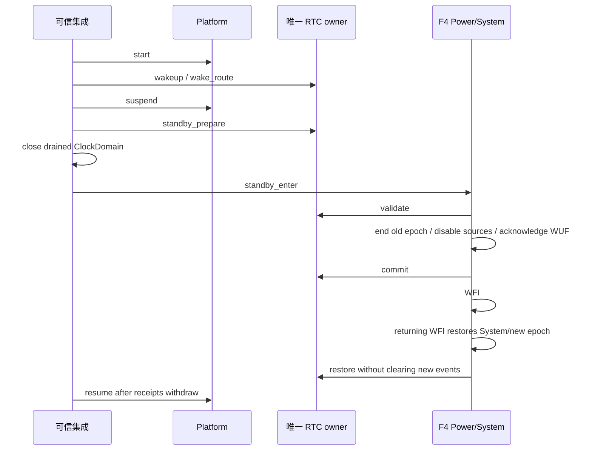

# F4 RTC 与低功耗软件参考

本目录使用 public typed factory、RTC、`stm32f4_power.h` 和
`clock_domain_owner.h`，验证三个精确器件的配置、公开接口和 ARM 链接。它不是已
接线的开发板，未执行 Standby、测量晶振或证明 VDD/VBAT 保留。

| 配置前缀 | 精确型号 | 已选 System PLL | RTC |
| --- | --- | --- | --- |
| `f411re` | STM32F411RET6 | HSI16，M16/N384/P4/Q8，96 MHz | 显式 LSE32768 晶体 |
| `f446ze` | STM32F446ZET6 | HSI16，M16/N336/P2/Q7，168 MHz | 显式 LSE32768 晶体 |
| `f479ni` | STM32F479NIH6 | HSI16，M10/N210/P2/Q7，168 MHz | 显式 LSE32768 晶体 |

每颗器件各有 `adopt-retained` 和 `provision-empty` 两个配置。前者要求产品已准备
并证明保留日历有效；后者只接受空备份域和配置中的完整初始日期。两种策略都不会
自动 reset backup domain。所有 Board 文件中的 LSE 和 3.3 V 都是显式软件假设，
实际产品需要自己的接线、供电、晶体和版本事实。

`consumer.c` 是单线程可信集成：提供一个静态 ClockDomain，没有额外时间借用者；
产品添加任务、IRQ、DMA 或 deadline 使用者后，必须显式登记并完整排空。示例取得
同一 RTC，配置 wakeup 后挂起 Platform，取得 RTC Standby receipt，再关闭 domain
并请求 Standby。真实 Standby 通过复位结束；若 WFI 返回，先核对新 epoch 和残留
receipt，再恢复 Platform。失败 receipt 与 domain 都具有静态存储，不会因函数
返回丢失 owner。示例不自动处理 F479 reset workaround，也不清除既有业务标志。



从源码仓库或 verified Source SDK 构建，例如：

```sh
cmake -S tests/contracts/stm32f4_power -B build/f411-power -G Ninja \
  -DCMAKE_TOOLCHAIN_FILE="$PWD/cmake/toolchains/arm-gcc.cmake" \
  -DNEXUS_SOURCE_ROOT="$PWD" \
  -DNEXUS_ASSEMBLY_FILE="$PWD/tests/contracts/stm32f4_power/f411re-adopt-retained.toml"
cmake --build build/f411-power --target nexus_f4_power_consumer --parallel 1
```

F446 PC13 wake 与晶体 LSE 冲突；此参考只使用 RTC wake。F411 没有 Backup SRAM。
F479 的 RTC Standby 再次进入受 ES0321 §2.2.13 限制，保留 SBF/WUF 时只报告并拒绝，
后续清 SBF 和系统复位必须由产品明确授权。其他模式与实板状态参见
[System 与低功耗契约](../../../soc/stm32/stm32f4/README-system-power.md)。
