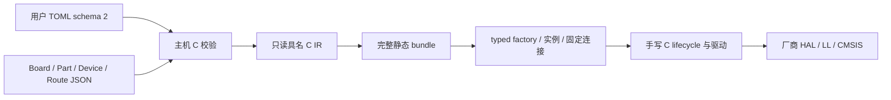

# Host C 配置工具

本目录是 STM32F4 配置入口的 C11 迁移试点。解析、校验和生成由真正的主机
C 程序完成；固件只编译静态 C 对象和手写 C 驱动。本工具尚未替换根构建中的
现有默认入口，也不代表所有维护模式已迁移。

Host 表示开发电脑：本工具在构建前运行，不进入 MCU 镜像。配置工具采用 C 或
Python 不决定固件的速度和 RAM／Flash 占用；成本取决于生成的静态对象和实际
链接的驱动。主机工具使用堆也不意味着固件需要堆。

默认生产入口仍是 `tools/configure/configure.py`。本目录用于验证另一种主机实现，
不要求用户先构建本工具才能使用平台。当前优先保证固件硬件行为和生命周期由
手写 C 维护，主机只校验配置并生成静态连接；主机语言迁移单独评估维护收益。



箭头表示输入或静态连接，不代表每次 I/O 多一层转发。factory 仅返回现有接口，
不分配内存、不初始化设备、不获取锁。C IR 的可变解析器对象保留在不透明 owner
内部；公开借用接口均为 `const`，由 `nxconfig_destroy()` 统一释放主机内存。

## 当前边界

已实现的完整切片是 `baremetal`、`hse8-pll168`、已有精确 F407 Part/Board 事实，
以及 GPIO input/output、UART irq/irq-byte-event 的 byte/event RX、SPI short-poll
和显式 CS endpoint。UART 的 `irq` 是同一维护模式的作者侧别名。其他后端、模式、
类别和未知选项均拒绝，不会自动选择替代模式。新增官方 device 目录项只证明 SDK
编译身份，不能替代 Part 的引脚、存储、时钟和模式资源事实。

- TOML 只允许 schema 2；Board 名称和 `board_package` 必须二选一。
- `board_package` 相对作者 TOML 定位；显式绝对路径也可用。
- 精确 Part 引用 `devices.json` 的器件标识，复用宏、启动文件和 IRQ 几何。
- APB 频率来自控制器 `clock_domain` 和已选时钟记录，不维护第二张控制器映射表。
- 校验封装引脚、AF、route、controller、mode、板级保留资源和硬件选件。
- Controller 独占；GPIO 按 pad 独占；SPI CS 与其他 pad 的所有权冲突会拒绝。
- RX 容量为 1～65535 个 byte/event；默认 64，UART 默认 115200 baud、IRQ 优先级 5。
- 栈默认 2048 bytes、要求 8-byte 对齐；RAM/Flash 默认物理上限；libc heap 必须为 0。
- 主机工具可使用堆；输出仅为精确定容静态存储，不建立最大实例池。

硬件初始化、等待、读回、rollback、恢复和调度不由 emitter 拼装。输出的 private
冷态连接交给手写 C adapter；system/PLL 先由外部明确的启动 owner 建立。
公共 `nexus_factory_strong.h` 不暴露 SDK 类型；跨类别引用会在编译期失败。

## 离线构建与使用

要求 Linux、原生 C11 编译器、CMake ≥ 3.31、Ninja。构建工具本身不需要 ARM
编译器、初始化 MCU SDK，也不会联网。两个 parser 由组织托管 gitlink 和独立锁
确定：`ext/tomlc99`、`ext/cjson`。CMake 检查各自 C/H/LICENSE 的长度与 SHA-256；
输入不符直接失败。tomlc99 是已固定的 TOML 1.0 实现，其上游已推荐后继 tomlc17；
cJSON 固定官方 v1.7.19。两者均保留 MIT 许可，不进入固件链接。

```sh
cmake -S tools/nxconfig -B /tmp/nexus-nxconfig -G Ninja
cmake --build /tmp/nexus-nxconfig --parallel 1
/tmp/nexus-nxconfig/nxconfig inspect --source-root "$PWD" \
  --assembly tools/configure/assemblies/qiming-baremetal.toml
mkdir -p build/nxconfig
chmod 700 build/nxconfig
/tmp/nexus-nxconfig/nxconfig generate --source-root "$PWD" \
  --assembly tools/configure/assemblies/qiming-baremetal.toml \
  --output build/nxconfig/generated
```

`--output` 的父目录需已存在、由当前用户持有，且组及其他用户没有写权限；输出
目录须专用。生成文件显式使用 `0600`，不依赖进程 umask。首次生成接受不存在的目录；后续
更新只接受拥有正确标记且不含外来文件的目录。输入文件须为普通文件，拒绝最终
路径的符号链接。生成前后都核对原始输入字节；变化会拒绝发布。每个输入的角色、
长度和 SHA-256 写入 manifest，路径位置不影响相同输入的输出字节。

生成器在同一父目录写完整 staging，刷新各文件，再以 Linux `renameat2` exchange
替换已有 bundle；首次发布使用原子 `RENAME_NOREPLACE`，拒绝覆盖预检后出现的
目标。同一路径有文件锁，已拥有 bundle 的
完整切换不暴露一半新文件。等价输出保留所有文件时间戳。外来文件、符号链接或
输入重叠均拒绝。父目录及其祖先路径必须在调用期间保持稳定。文件锁只协调遵循
协议的生成者；恶意外部 rename、祖先目录重绑定或同 UID 篡改不在保证范围内。
该边界用于构建一致性，不是执行不可信 provider 的沙箱。

## 验证与后续迁移

测试使用仓库固定的 GoogleTest/GoogleMock。完整测试还要求已准备的 ARM GCC 与所选
官方 SDK；CMake 在测试打开时查找 `arm-none-eabi-gcc`，也可显式传入
`-DNXCONFIG_TEST_ARM_CC=/完整路径/arm-none-eabi-gcc`。以下命令编译同一 C 实现：

```sh
cmake -S tools/nxconfig -B /tmp/nexus-nxconfig-tests -G Ninja \
  -DNXCONFIG_BUILD_TESTS=ON
cmake --build /tmp/nexus-nxconfig-tests --parallel 1
ctest --test-dir /tmp/nexus-nxconfig-tests --output-on-failure
```

根 Native 测试也注册同一合同集 `nexus_nxconfig_test`，不维护另一份解析器或 runner。
测试覆盖真实 TOML、严格拒绝、资源冲突、无 SDK 的事实解析、输出所有权、输入变化、
重复生成和强类型消费。使用 CMake 固定的 ARM GCC 编译两个实际生成配置；可通过环境变量
`NXCONFIG_TEST_ARM_CC` 显式替换测试编译器。缺工具直接失败，不跳过。该编译
验证不代表实板 HIL。

后续扩展以完整模式为单位补充具名 IR 和手写 C adapter。若评估后决定替换默认
入口，须先完成其余维护模式、OS 策略、完整平台生命周期、生产 bundle 契约与消费
迁移；不会同时保留两个生产权威，也不会让未支持模式静默回落。全面替换不是本轮
固件 C 化的前置条件。
